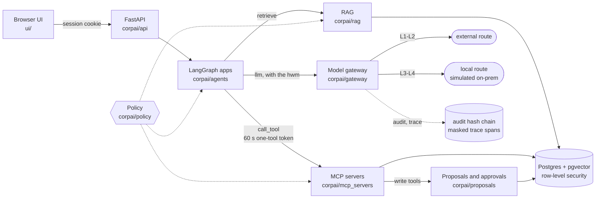

# ABC Tech internal AI platform (simulated)

**English** | [中文](README.zh.md)

A working simulation of the internal AI platform a ~70-person B2B SaaS company would run: permission-aware RAG, MCP tool servers, LangGraph apps, a model gateway that routes by data level, human approval for every write, and a hash-chained audit log. The company is **ABC Tech AB**, a fictional route-planning SaaS vendor in Stockholm, Sweden (EU, GDPR, EUR).

> **Everything here is simulated.** The company, its staff, customers, contracts, ledger and résumés are generated by `corpai/synth`; every domain ends in `.example`. Both model routes call the DeepSeek API: the `local` route only *plays* an on-prem model, so data that the platform keeps "local" in this demo does in fact go to DeepSeek when live mode is on. Tests use a deterministic fake model and need no API key; the offline demo needs none either, because it replays runs recorded with the real DeepSeek model on 2026-10-08.

What the project is meant to show:

- **Who may see what is enforced twice**: by a table-driven policy engine in Python and by Postgres row-level security underneath it, with tests that the two agree for all 14 personas.
- **The model is never trusted with permissions**: identity, data level and route come from code; the model only ever gets data the user could read anyway.
- **Confidential data stays on the local route**: every model call goes through one gateway that classifies the content, takes the session's high-water mark and refuses to send L3/L4 to the external route, even when the local model is down.
- **Writes need a person**: tools that write only file proposals; external or irreversible ones need a second person (four-eyes).
- **Everything is on record**: an append-only, hash-chained audit log anchored outside the database, and traces masked by data level.

## Architecture



One process serves the API, the seven MCP servers (mounted in-process, reached over real MCP streamable HTTP), the LangGraph runtime and the UI. Postgres 16 with pgvector runs embedded through [pgserver](https://pypi.org/project/pgserver/), so there is no Docker and no system database.

| Part | Package | Spec |
|---|---|---|
| Request path end to end | | [architecture §1](docs/architecture.md#1-the-shape-of-a-request) |
| Identity, sessions, ACL groups, tool and gateway tokens | `corpai/identity` | [§5](docs/architecture.md#5-identity-groups-and-tokens-a3), [§5.1](docs/architecture.md#51-clearance-and-acl-assignment-the-data-contract-between-synth-policy-and-rls) |
| Policy engine (`decide`, `rag_filter`, `tool_allowed`, `can_approve`) and RLS | `corpai/policy`, `migrations/` | [§6](docs/architecture.md#6-policy-a3), [§4](docs/architecture.md#4-database) |
| Classification, DLP, secret scrubbing | `corpai/classify` | [§7](docs/architecture.md#7-classification-and-dlp-a2) |
| Model gateway: routing, outage switches, budgets, egress inventory | `corpai/gateway` | [§8](docs/architecture.md#8-model-gateway-a4) |
| Audit log and traces | `corpai/audit`, `corpai/trace` | [§9](docs/architecture.md#9-audit-and-trace-a1) |
| RAG (hybrid pgvector + full-text, filtered by policy and RLS) | `corpai/rag`, `corpai/embed` | [§10](docs/architecture.md#10-rag-b1) |
| MCP servers, tool client, proposals | `corpai/mcp_servers`, `corpai/mcp_client.py`, `corpai/proposals` | [§11](docs/architecture.md#11-mcp-servers-and-the-tool-client-b2) |
| LangGraph runtime, router, high-water mark, Rule of Two | `corpai/agents` | [§12](docs/architecture.md#12-langgraph-runtime-b3) |
| API and UI | `corpai/api`, `ui/` | [§13](docs/architecture.md#13-api-b3-extended-by-milestones), [§14](docs/architecture.md#14-ui-b4), [§18](docs/architecture.md#18-api-payloads-contract-between-corpaiapi-and-ui) |
| The synthetic company | `corpai/synth` | [§15](docs/architecture.md#15-synthetic-company-a5), [company.md](docs/company.md) |

## Apps

The router picks the graph in code from the app the user chose; a user sees only the apps their role may start ([§12](docs/architecture.md#12-langgraph-runtime-b3), `config/agents.yaml`). Details per app: [§16](docs/architecture.md#16-milestone-slices).

| App | Who can start it | What it does |
|---|---|---|
| `qa` | everyone | Q&A over the document collections the user may read, plus read-only tools (CRM, tickets, metrics, ...). Citations are checked by code; passages that address AI systems are withheld. |
| `legal_review` | legal, CEO | **review** a stored, pasted or uploaded contract against the playbook (the vendored [Clause Check](corpai/legal/clausecheck/NOTICE.md) per-clause loop, local route only, embedded instructions flagged and ignored); **due** contracts by month (SQL only); **draft** from templates (tier-2 proposal); **send** (tier-3, four-eyes). |
| `report` | CEO, heads of department | Management report built from **signed** metric snapshots, written by the model with placeholders and checked by code (every number, id and date); sections the reader may not see are listed as "no permission". Watermarked export. |
| `sales_profile` | sales, CEO | Company profile from public web pages in an isolated sub-agent (external route, L1), intent and fit scores computed in code from the CRM, strategy on the local route; a follow-up email becomes a tier-3 proposal. |
| `hr_headcount` | CEO, heads, HR | Headcount by department (groups under 5 hidden in SQL); hiring budgets only for those allowed to see them. |
| `hr_screening` | HR | Evidence per hard requirement of a role, each backed by a verbatim quote; protected attributes are removed first; no score, rank or recommendation. A person records the decision with a reason. |
| `hr_candidates` | everyone outside IT | Read-only list of candidates for the requisitions the user works on (hiring manager, recruiter); everything else is an explicit denial. |

Beside the apps, the UI has an approvals inbox, metric sign-off for the CFO, a trace viewer, the audit viewer (security auditor), outage switches (platform admin) and a "same question, different people" comparison page.

## Personas

Fourteen fixed demo users (same ids and names for every seed, `corpai/synth/personas.py`):

| Persona key | Name | Title | Clearance | Apps |
|---|---|---|---|---|
| `ceo` | Helena Lindberg | Chief Executive Officer | L4 | qa, legal_review, report, sales_profile, hr_headcount, hr_candidates |
| `exec_staff` | Johan Ekström | Chief of Staff | L3 | qa, hr_candidates |
| `sales_head` | Karin Holm | Head of Sales | L4 | qa, report, sales_profile, hr_headcount, hr_candidates |
| `sales_staff` | Erik Lindqvist | Account Executive | L3 | qa, sales_profile, hr_candidates |
| `eng_head` | Anders Nyberg | Chief Technology Officer | L4 | qa, report, hr_headcount, hr_candidates |
| `eng_staff` | Oskar Berg | Backend Engineer | L3 | qa, hr_candidates |
| `legal_head` | Sofia Wallin | Head of Legal | L4 | qa, legal_review, report, hr_headcount, hr_candidates |
| `legal_staff` | Viktor Sandberg | Legal Counsel | L4 | qa, legal_review, hr_candidates |
| `finance_head` | Annika Strand | Chief Financial Officer | L4 | qa, report, hr_headcount, hr_candidates (+ metric sign-off) |
| `finance_staff` | Linnea Dahl | Financial Accountant | L4 | qa, hr_candidates |
| `hr_head` | Maria Engström | Head of People | L4 | qa, report, hr_headcount, hr_screening, hr_candidates |
| `hr_staff` | Elin Forsberg | Talent Acquisition Partner | L4 | qa, hr_headcount, hr_screening, hr_candidates |
| `platform_admin` | Daniel Sjögren | Platform Administrator | L2 | qa (+ outage switches, trace metadata) |
| `auditor` | Ida Lund | Security Auditor | L2 | qa (+ audit log) |

Clearance is a ceiling; ACL groups (department, ownership, project, matter, requisition, time-boxed grants) decide row by row ([§5.1](docs/architecture.md#51-clearance-and-acl-assignment-the-data-contract-between-synth-policy-and-rls)). The platform admin and the security auditor run the system but read no business content.

## Security model

| Control | What it means here | Spec |
|---|---|---|
| Data levels L1–L4 and routing | L1 public, L2 internal, L3 confidential (personal data, contracts, CRM), L4 restricted (pay, performance, litigation, vulnerabilities). The gateway routes `external` only at L1–L2; L3–L4 always go `local`. The route is computed, never passed by a caller. | [§8](docs/architecture.md#8-model-gateway-a4), [design review §4 (zh)](docs/design-review.md#四数据分级与路由) |
| High-water mark | Each conversation carries `sensitivity_hwm` with a max reducer: once a session has read L3 data, every later model call in it is local. Only a new thread resets it. | [§12](docs/architecture.md#12-langgraph-runtime-b3) |
| Fail-closed | A missing label or a classifier error counts as L4; no person-name gazetteer loaded means at least L3; `local` down means an error, never a fallback to `external`; a query outside a principal transaction sees no rows. | [§4](docs/architecture.md#4-database), [§7](docs/architecture.md#7-classification-and-dlp-a2), [§8](docs/architecture.md#8-model-gateway-a4) |
| Policy and RLS, twice | `policy.decide()` and the RAG filter decide in Python; Postgres RLS on every content table checks the same labels again for the non-owner app role. A permission matrix test and an RLS test must agree. | [§4](docs/architecture.md#4-database), [§6](docs/architecture.md#6-policy-a3), [§10](docs/architecture.md#10-rag-b1) |
| Short-lived MCP tool tokens | Every tool call gets a fresh token for exactly one tool, valid 60 s, with the acting agent in `act`; separate signing keys for sessions, tool tokens and gateway tokens. The MCP server re-reads the user and re-checks policy. | [§5](docs/architecture.md#5-identity-groups-and-tokens-a3), [§11](docs/architecture.md#11-mcp-servers-and-the-tool-client-b2) |
| Rule of Two | Each graph node declares whether it touches untrusted input, sensitive data or external actions; a checker fails any graph where one path holds all three without a human gate. | [§12](docs/architecture.md#12-langgraph-runtime-b3) |
| Four-eyes approvals | Write tools file proposals; tier 3 (outbound or irreversible) can never be approved by the requester. Executors re-check the parameter hash. | [§6](docs/architecture.md#6-policy-a3), [§11](docs/architecture.md#11-mcp-servers-and-the-tool-client-b2) |
| Hash-chained audit | `audit.log` is append-only (triggers refuse update, delete and truncate), each row hashes the previous one, and HMAC-signed anchors outside the database catch a cut tail or re-hashed history. Only the security auditor reads it. | [§9](docs/architecture.md#9-audit-and-trace-a1) |
| Masked traces | Spans are masked once, at span end, with their final level: L3 spans keep text with sensitive spans replaced, L4 spans keep no text. | [§9](docs/architecture.md#9-audit-and-trace-a1) |
| Egress inventory and DLP | `config/egress.yaml` lists every destination with its maximum level; secrets are scrubbed before any model call and a DLP scan can only move a call to `local`. | [§7](docs/architecture.md#7-classification-and-dlp-a2), [§8](docs/architecture.md#8-model-gateway-a4) |
| Untrusted content | Web pages, uploaded contracts and résumés are `trust=untrusted` and only reach nodes with no write or outbound tools; planted prompt injections are part of the test data. | [ENGINEERING.md](docs/ENGINEERING.md#security-rules-that-code-review-enforces), [§16](docs/architecture.md#16-milestone-slices) |

The threat model is in [docs/threat-model.md](docs/threat-model.md).

## Quick start (Windows)

Developed and tested on Windows 11 with PowerShell. You need Python **3.12** (`py -3.12`) and Git. Node.js is optional (the UI behaviour tests run the demo in Node and are skipped without it). No Docker, no Postgres install and no admin rights: Postgres comes inside the `pgserver` pip package.

### 1. Install

```powershell
git clone https://github.com/Xinshuer/company-ai-platform.git
cd company-ai-platform
py -3.12 -m venv .venv
.\.venv\Scripts\Activate.ps1          # if scripts are blocked: Set-ExecutionPolicy -Scope Process Bypass
python -m pip install --upgrade pip
python -m pip install -r requirements.lock.txt
$env:PYTHONUTF8 = "1"                  # Swedish and Chinese text on any console code page
python -m corpai                       # lists the commands (db, synth, ingest, metrics, serve, ...)
```

All commands run from the repo root. Data goes to `.data/` (git-ignored) unless `CORPAI_DATA_DIR` points elsewhere.

### 2. Offline demo (no backend)

Open `ui/index.html` in a browser (double-click it, or `Start-Process ui\index.html`). Opened from disk, the page runs in **demo mode**: pick any of the 14 personas and click through recorded runs, approvals, the audit log and the outage switches. The UI starts in Chinese; the `EN` button switches to English. The model text in these runs is a real DeepSeek recording made on 2026-10-08 with `python -m corpai demo-record` (full company, seed 7) and is labelled as a recording; a run against the server calls the model again and may word things differently.

### 3. Run the platform (fake model)

```powershell
python -m corpai db up                       # start the embedded Postgres, apply migrations
python -m corpai synth                       # generate ABC Tech AB (seed 7); --small for a lighter company
python -m corpai ingest                      # load the generated documents into RAG
python -m corpai metrics refresh --period 2026-Q3
python -m corpai metrics refresh --period 2026-09
python -m corpai metrics sign    --period 2026-Q3 --as finance_head --all
python -m corpai metrics publish --period 2026-Q3 --as finance_head --all
python -m corpai serve                       # http://127.0.0.1:8000
```

Reports cite signed snapshots only, so the CFO signs 2026-Q3 here; 2026-09 stays a draft so the CFO has something to sign in the UI. `--as` is a password-less demo login and is audited as one.

Open <http://127.0.0.1:8000> and pick a persona (demo login). Some things to try:

| Persona | App | Input | What to look for |
|---|---|---|---|
| Erik Lindqvist (sales) | Ask | `What does GDPR Article 28 require from a processor?` | L1, route `external` |
| Erik Lindqvist (sales) | Ask, same thread | `Which accounts do I own and what is their status?` | CRM data: L3, route `local` from here on |
| Viktor Sandberg (legal) | Contract review | contract `C-0004` | embedded instruction flagged, local, no proposal filed |
| Helena Lindberg vs Anders Nyberg | Management report | `2026-Q3 management report` | the CTO's report leaves out the finance issues, the sales pipeline figures and the whole legal section, and lists them under "Not shown to you" |
| Erik Lindqvist (sales) | Account profile | `Havenmeer Distributie B.V.` | web extraction `external` at L1, scores and strategy `local` |
| Elin Forsberg (HR) | Résumé screening | `CAND-007` | protected attributes removed, injection flagged, evidence only, waits for Elin's decision |
| Ida Lund (auditor) | Audit | | the hash chain verifies; every action above is on record |
| Daniel Sjögren (admin) | Switches | turn on `local_down` | confidential requests now fail instead of going external |

(The demo data is mostly English, so English questions match best: the default fake embedder only matches shared words; cross-lingual retrieval needs fastembed, below.)

`python -m corpai serve` refuses a non-loopback `--host` while demo login is on, and the server answers only requests addressed to a loopback name or the `--host` given (other names go in `CORPAI_ALLOWED_HOSTS`), which stops DNS rebinding. Stop it with `Ctrl+C`, then `python -m corpai db down`.

### 4. Live mode (real DeepSeek API, costs money)

Put your own key in your **user** environment once (it is read from the environment at call time and never written anywhere by the platform), then open a new terminal in the repo folder:

```powershell
[Environment]::SetEnvironmentVariable("DEEPSEEK_API_KEY", "<your DeepSeek API key>", "User")
```

```powershell
.\.venv\Scripts\Activate.ps1
$env:CORPAI_LLM = "live"
python -m corpai serve
```

`GET /api/health` now reports `"mode": "live"`. Both routes go to `api.deepseek.com` (see the note at the top). If every run ends with "Model service error" (`backend_error`), the key is probably missing in the terminal that started the server: `[bool]$env:DEEPSEEK_API_KEY` prints `True` or `False` without showing it. `Remove-Item Env:CORPAI_LLM` returns to the fake model.

Independently of the model, `$env:CORPAI_EMBED = "fastembed"` switches retrieval from the fake hashing embedder to a local multilingual embedding model (about 240 MB, downloaded once from huggingface.co to `.cache/fastembed`; texts and embeddings never leave the machine). Set it for `ingest`, which then re-embeds the documents, and for `serve`.

### 5. Tests and evals

```powershell
python -m pytest                                    # the full suite, fake model (about 4,700 tests, ~11 min)
python -m pytest tests/security                     # permission matrix, canaries, chaos, red team, Rule of Two (~2.5 min)
python -m pytest tests/security/test_rule_of_two.py # one file
python -m pytest evals -m eval                      # eval suites on the fake model (~2 min)
```

The test fixtures start their own Postgres under `.data/test/<pid>` and delete it afterwards. **Do not run pytest with `CORPAI_DATA_DIR` set to a database you want to keep**: the fixture deletes that directory. Tests always use the fake model and remove the API key from the process.

Live evals call DeepSeek and cost money. They run live only when `CORPAI_LLM=live` **and** every path on the command line is under `evals/`:

```powershell
$env:CORPAI_LLM = "live"; $env:CORPAI_EVAL_RUNS = "3"
python -m pytest evals/legal -m eval
Remove-Item Env:CORPAI_LLM, Env:CORPAI_EVAL_RUNS
```

Results of the live runs are in [docs/evals-live.md](docs/evals-live.md).

### 6. Other commands

```powershell
python -m corpai db status                 # running or stopped
python -m corpai db reset --yes            # delete the database (keeps the old audit anchors, renamed)
python -m corpai metrics list --as sales_staff
python -m corpai metrics show --period 2026-Q3 --as ceo --metric opex_actual
python -m corpai prune                     # delete checkpoints of threads idle > 30 days
python -m corpai demo-record --small --out-dir $env:TEMP\demo-fixtures   # dry run of the demo recorder (fake model)
```

The offline demo's fixtures (`ui/fixtures/*.js`) come from `$env:CORPAI_LLM = "live"; python -m corpai demo-record`: it starts its own throwaway Postgres, generates the full company and drives the real API as each persona (about 15 minutes and 0.45M tokens; `--only legal` and so on re-records one app). Without `--out-dir` it overwrites the shipped fixtures, and a recording made on another day also needs the date in `ui/js/i18n.js` updated (a test checks it).

Environment variables (`CORPAI_DATA_DIR`, `CORPAI_LLM`, `CORPAI_EMBED`, `CORPAI_DEMO_LOGIN`, `CORPAI_SIM_TODAY`, ...): [architecture §3](docs/architecture.md#3-core-types-frozen). The simulation date is 2026-10-01; security controls (session and grant expiry, budgets) run on real time.

## Quick start (macOS)

Apple Silicon with macOS 14 or later (one of the pinned wheels, `onnxruntime`, needs macOS 14). You need Python **3.12 exactly**: `pgserver` 0.1.4 has no wheels for 3.13 or later, and the system `python3` is 3.9. On macOS and Linux the embedded Postgres listens on a Unix socket in `.data/pg`, so clone outside iCloud-synced folders such as `~/Desktop` or `~/Documents`.

```bash
brew install python@3.12                         # Node.js (brew install node) is optional, as on Windows
mkdir -p ~/dev && cd ~/dev
git clone https://github.com/Xinshuer/company-ai-platform.git
cd company-ai-platform
python3.12 -m venv .venv
source .venv/bin/activate
python -m pip install --upgrade pip
python -m pip install -r requirements.lock.txt
python -m corpai                                 # lists the commands
```

Offline demo: `open ui/index.html`. If a browser shows a blank page from disk, serve the folder instead: `python -m http.server 8080 --bind 127.0.0.1 -d ui`, then open <http://127.0.0.1:8080> (the page still runs in demo mode).

Running the platform, the things to try and the tests are the same commands as in steps 3, 5 and 6 above. Differences:

- Live mode: read the key without echoing it or writing it to the shell history, then start the server:
  ```bash
  read -rs 'DEEPSEEK_API_KEY?DeepSeek API key: '; echo; export DEEPSEEK_API_KEY   # zsh; bash: read -rsp "DeepSeek API key: " DEEPSEEK_API_KEY
  export CORPAI_LLM=live && python -m corpai serve
  ```
  `unset CORPAI_LLM` returns to the fake model.
- Full test suite: macOS allows 256 open files per shell by default; run `ulimit -n 4096` first.
- `PYTHONUTF8` is not needed.

## Repository layout

```text
corpai/                 the platform, one Python package (no src/ layout)
  agents/               LangGraph runtime, router, runner, the apps (qa.py, legal/, report/, sales/, hr/)
  api/                  FastAPI app and routes (routes_<area>.py)
  audit/  trace/        hash-chained audit log with external anchors; masked trace spans
  classify/             levels, detectors, DLP, secret scrubbing, résumé redaction
  gateway/              model gateway, fake LLM, OpenAI-compatible backend, egress checks, ops switches
  identity/  policy/    directory, sessions and tokens; the policy engine and its rule tables
  mcp_servers/          one MCP server per domain (crm, code, docs, finance, hris, legal, web)
  proposals/            proposal lifecycle and executors for the simulated systems
  rag/  embed/          ingestion and hybrid retrieval; fake and fastembed embedders
  legal/  metrics/  sales/  hr/   domain logic of the milestones (legal/clausecheck is vendored)
  synth/                the synthetic company: people, CRM, ledger, contracts, corpus, planted issues
  db/  cli/             embedded Postgres lifecycle and migrations; python -m corpai commands
config/                 models, egress inventory, agent allowlists, source levels, metric definitions
migrations/             plain SQL, applied in order; every table with its grants and RLS policy
playbooks/              versioned playbooks used by the graphs
ui/                     static HTML/JS UI, no build step; ui/fixtures/ holds the offline demo recordings
tests/                  unit, integration and security tests (fake model)
evals/                  eval suites: qa golden set, routing robustness, legal, report, sales, hr
docs/                   spec, decisions, design review, issues log, company script
compliance/             compliance documents for the simulated company
```

## Documentation

| Document | Language | What it is |
|---|---|---|
| [docs/architecture.md](docs/architecture.md) | en | The authoritative spec (§1–§18): packages, tables, signatures, API payloads. [Chinese reading version](docs/architecture.zh.md). |
| [docs/ENGINEERING.md](docs/ENGINEERING.md) | en | How code is written, tested and run; the security rules code review enforces. |
| [docs/decisions.md](docs/decisions.md) | zh | Decision log: scope, jurisdiction, routes, data levels, tech choices. |
| [docs/design-review.md](docs/design-review.md) | zh | The design review the spec was built from: data levels, routing examples, permission model. |
| [docs/issues-log.md](docs/issues-log.md) | zh | Every problem found while building it, and how it was fixed or why it was deferred. |
| [docs/company.md](docs/company.md) | en | The fictional company: departments, personas, customers, planted issues. |
| [docs/threat-model.md](docs/threat-model.md) | en ([zh](docs/threat-model.zh.md)) | Threats, mitigations and residual risks. |
| [compliance/](compliance/) | | GDPR and EU AI Act documents for the simulated company. |
| [docs/real-deployment.md](docs/real-deployment.md) | en ([zh](docs/real-deployment.zh.md)) | What would change to run this for real at a 70-person Swedish company. |
| [docs/evals-live.md](docs/evals-live.md) | | Live eval runs against the real model. |

## Known limitations

As of 2026-10-08, after the wrap-up triage. The history and status of each item is in the [issues log, section 十五](docs/issues-log.md#十五收尾阶段实时模型文档合规低危问题评估2026-10-08); the risk ratings are in [threat model §8](docs/threat-model.md#8-open-risks).

- **A demo, not a deployment.** One process, embedded Postgres, demo login without passwords, both routes on the DeepSeek API. With real data, confidential content would go to a third-country API with no data processing agreement or transfer mechanism: the first thing to change before go-live ([compliance/](compliance/README.md)). [docs/real-deployment.md](docs/real-deployment.md) lists what else would change.
- **The host is trusted.** The embedded Postgres accepts every loopback connection without a password, so a local process can connect and set the `app.*` session variables that row-level security reads; RLS here guards against application bugs, not against someone on the machine.
- **Per-process state.** Legal uploads live in process memory; the one-run-per-thread lock and the gateway's concurrency limits are per process, so the server cannot simply run several workers.
- **Audit anchors sit on the same host** as the database (a file plus an HMAC key under `.data/`); rows appended after the newest anchor can still be dropped unnoticed.
- **Retrieval:** the default fake embedder only matches shared words, so cross-lingual questions need `CORPAI_EMBED=fastembed`; full-text search uses the English configuration with no Chinese word segmentation.
- **Classification is pattern- and gazetteer-based.** It errs towards higher levels, but a confidential fact with no detectable marker (a contract clause without an amount, the name of someone in no table) can still be rated L2 and go to the external route.
- **Résumé redaction is pattern-based**, in English, German, Chinese and Swedish. A résumé in another language, or wording the patterns miss, reaches the screening model as written; the synthetic résumés are English, German and Chinese, so the Swedish patterns are proven by tests only.
- **GDPR erasure and retention are partial.** `trace.erase_subject` reaches tool and retrieval spans, not checkpoints, not model calls made by domain code (HR screening, legal review, report) and not `legal.reviews`. Only checkpoints (`prune`, run by hand) and in-memory uploads expire; traces, the egress log, proposals and reviews are kept.
- **Data-subject flows are missing:** no opt-out or suppression list for sales follow-up e-mails, no notice to candidates, and no way to decide on a candidate without the AI step ([compliance/](compliance/README.md)).
- **Model quality is measured on one day (2026-10-08) with one model version** ([docs/evals-live.md](docs/evals-live.md)). The legal review still flags a conditional AI Act clause the golden set expects it to accept; `legal.draft`, the report writer, the sales extraction and the headcount note have no live eval. A legal review costs about 35 model calls and 90k tokens, so the default daily budget allows about 20 per department.
- **Quotas and tokens:** budgets are per department per day, not per user, and there is no API rate limit; tool and gateway tokens can be replayed until they expire (no `jti` cache).
- **Database roles:** metric refresh SQL runs as the owner role, guarded by an `EXPLAIN` check of the tables it reads and a read-only transaction instead of a read-only role.
- **API details:** a graph's input error comes back as status `done` with `output.data.error`, not as a 400; a run waiting for a person's decision is `done` with `awaiting_decision` (there is no `waiting_input` status); report export looks back at most 200 checkpoints of a thread; the sales intent step's level in the API says L3 even when the score was refused (the UI shows the refusal).
- **Policy choices that may surprise:** HR staff are refused the department headcount summary (deny by default); everyone sees "Candidates" in the navigation and gets an explicit answer if they hire for nothing; leavers leave at month end and payroll is by whole month; the per-node tool contracts in `config/agents.yaml` are enforced by each graph's Rule-of-Two test, not by the loader; review requesters show by name only while demo login is on, otherwise by user id.
- **Supply chain:** dependencies are pinned without hashes; there is no SBOM, vulnerability scan or secret-scanning hook.
- **Not built:** a break-glass flow (the audit event is reserved), an agent that files code tickets or journal entries (three write tools no agent holds), a scheduled metric refresh.
