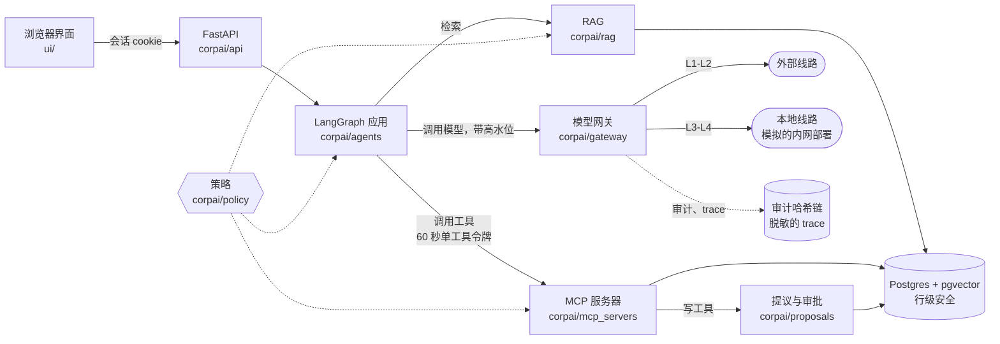

# ABC Tech 内部 AI 平台（模拟项目）

[English](README.md) | **中文**

这是一个能实际运行的模拟项目：一家约 70 人的 B2B SaaS 公司内部会用的 AI 平台。包括按权限过滤的 RAG、MCP 工具服务器、LangGraph 应用、按数据级别选线路的模型网关、所有写操作都要人审批，以及带哈希链的审计日志。公司叫 **ABC Tech AB**，是虚构的：总部在瑞典斯德哥尔摩，做物流路线规划 SaaS（欧盟，适用 GDPR，币种欧元）。

> **这里的一切都是模拟的。** 公司、员工、客户、合同、总账和简历全部由 `corpai/synth` 生成，所有域名都以 `.example` 结尾。两条模型线路底层都调用 DeepSeek API：`local` 线路只是“扮演”公司内网部署的模型，所以在实时模式下，演示里“留在本地”的数据实际上也发给了 DeepSeek。测试和离线演示用确定性的假模型，不需要 API key。

这个项目想展示的是：

- **谁能看什么，检查两遍**：Python 里的表驱动策略模块判断一次，下面的 Postgres 行级安全（RLS）再挡一次；有测试保证两者对 14 个演示身份的结论一致。
- **权限从不交给模型**：用户身份、数据级别和线路都由代码决定；模型拿到的数据，只会是这个用户本来就能看的。
- **机密数据只走本地线路**：所有模型调用都经过同一个网关。网关给内容分级、取本会话的高水位，L3/L4 绝不发往外部线路，本地模型宕机时也一样。
- **写操作要人点头**：会写东西的工具只生成提议；对外或不可逆的操作还要第二个人批准（四眼原则）。
- **一切留痕**：只追加、带哈希链的审计日志，锚点存在数据库之外；trace 按级别脱敏。

## 架构



一个进程同时提供 API、七个 MCP 服务器（挂在进程内，但走真实的 MCP streamable HTTP 协议）、LangGraph 运行时和界面。Postgres 16 和 pgvector 通过 [pgserver](https://pypi.org/project/pgserver/) 内嵌运行，不需要 Docker，也不需要装数据库服务。

| 部分 | 代码 | 规范 |
|---|---|---|
| 一个请求从头到尾的路径 | | [架构 §1](docs/architecture.zh.md#1-一个请求的完整路径) |
| 身份、登录会话、ACL 组、工具令牌和网关令牌 | `corpai/identity` | [§5](docs/architecture.zh.md#5-身份组与令牌a3)、[§5.1](docs/architecture.zh.md#51-clearance-与-acl-分配模拟数据策略rls-三方共同遵守的数据约定) |
| 策略模块（`decide`、`rag_filter`、`tool_allowed`、`can_approve`）和 RLS | `corpai/policy`、`migrations/` | [§6](docs/architecture.zh.md#6-策略a3)、[§4](docs/architecture.zh.md#4-数据库) |
| 数据分级、DLP、密钥清除 | `corpai/classify` | [§7](docs/architecture.zh.md#7-数据分级与-dlpa2) |
| 模型网关：选线路、宕机开关、预算、出口清单 | `corpai/gateway` | [§8](docs/architecture.zh.md#8-模型网关a4) |
| 审计日志和 trace | `corpai/audit`、`corpai/trace` | [§9](docs/architecture.zh.md#9-审计与-tracea1) |
| RAG（pgvector + 全文混合检索，由策略和 RLS 过滤） | `corpai/rag`、`corpai/embed` | [§10](docs/architecture.zh.md#10-ragb1) |
| MCP 服务器、工具客户端、提议 | `corpai/mcp_servers`、`corpai/mcp_client.py`、`corpai/proposals` | [§11](docs/architecture.zh.md#11-mcp-服务器与工具客户端b2) |
| LangGraph 运行时、路由、高水位、Rule of Two | `corpai/agents` | [§12](docs/architecture.zh.md#12-langgraph-运行时b3) |
| API 和界面 | `corpai/api`、`ui/` | [§13](docs/architecture.zh.md#13-apib3-搭骨架各里程碑扩展)、[§14](docs/architecture.zh.md#14-界面b4)、[§18](docs/architecture.zh.md#18-api-数据格式界面和后端之间的约定) |
| 模拟公司 | `corpai/synth` | [§15](docs/architecture.zh.md#15-模拟公司a5)、[company.md](docs/company.md) |

中文规范是阅读版；英文版 [architecture.md](docs/architecture.md) 是权威规范，两者有出入时以英文版为准。

## 应用

用户选了哪个应用，路由就用代码挑对应的图；每个人只看得到自己的角色能启动的应用（[§12](docs/architecture.zh.md#12-langgraph-运行时b3)，`config/agents.yaml`）。每个应用的细节见 [§16](docs/architecture.zh.md#16-各里程碑的纵向切片)。

| 应用 | 谁能启动 | 做什么 |
|---|---|---|
| `qa` 知识问答 | 所有人 | 在用户能读的文档集合里问答，可以调用只读工具（CRM、工单、指标等）。引用由代码核对；对 AI 系统说话的段落不交给模型。 |
| `legal_review` 合同审查 | 法务、CEO | **审查**合同库里的、粘贴的或上传的合同，对照 Playbook 逐条审（复用的 [Clause Check](corpai/legal/clausecheck/NOTICE.md) 逐条款循环，只走本地线路，合同里夹带的指令会被标出并忽略）；按月查**到期**合同（只跑 SQL）；按模板**起草**（风险档 2 的提议）；**发送**（风险档 3，四眼审批）。 |
| `report` 管理层报告 | CEO、各部门负责人 | 只用**已签核**的指标快照生成报告；模型写带占位符的文字，代码核对每个数字、编号和日期；读者无权看的部分明确写“无权限”。导出带水印。 |
| `sales_profile` 客户画像 | 销售、CEO | 在隔离的子 Agent 里根据公开网页做公司画像（外部线路，L1）；意向分和匹配度由代码根据 CRM 计算；策略建议走本地线路；跟进邮件变成风险档 3 的提议。 |
| `hr_headcount` 编制概览 | CEO、各部门负责人、HR | 按部门统计人数（少于 5 人的分组在 SQL 里就隐藏）；招聘预算只给有权看的人。 |
| `hr_screening` 简历筛查 | HR | 对照岗位的每条硬性条件找证据，每条都要引用简历原文；送模型前先去掉受保护的个人特征；不打分、不排名、不给建议。由人记录决定并写理由。 |
| `hr_candidates` 候选人 | IT 以外的所有人 | 只读列出自己参与的招聘岗位（用人经理、招聘专员）的候选人；其他一律明确拒绝。 |

除了这些应用，界面还有审批收件箱、CFO 的指标签核页、trace 查看、审计日志查看（安全审计员）、宕机开关（平台管理员），以及“同一个问题，不同的人问”的对比页。

## 演示身份

14 个固定的演示用户（每个随机种子下编号和姓名都一样，见 `corpai/synth/personas.py`）：

| persona_key | 姓名 | 职位 | 级别上限 | 应用 |
|---|---|---|---|---|
| `ceo` | Helena Lindberg | 首席执行官 | L4 | qa、legal_review、report、sales_profile、hr_headcount、hr_candidates |
| `exec_staff` | Johan Ekström | 幕僚长 | L3 | qa、hr_candidates |
| `sales_head` | Karin Holm | 销售负责人 | L4 | qa、report、sales_profile、hr_headcount、hr_candidates |
| `sales_staff` | Erik Lindqvist | 客户经理 | L3 | qa、sales_profile、hr_candidates |
| `eng_head` | Anders Nyberg | 首席技术官 | L4 | qa、report、hr_headcount、hr_candidates |
| `eng_staff` | Oskar Berg | 后端工程师 | L3 | qa、hr_candidates |
| `legal_head` | Sofia Wallin | 法务负责人 | L4 | qa、legal_review、report、hr_headcount、hr_candidates |
| `legal_staff` | Viktor Sandberg | 法务顾问 | L4 | qa、legal_review、hr_candidates |
| `finance_head` | Annika Strand | 首席财务官 | L4 | qa、report、hr_headcount、hr_candidates（另有指标签核） |
| `finance_staff` | Linnea Dahl | 会计 | L4 | qa、hr_candidates |
| `hr_head` | Maria Engström | 人力资源负责人 | L4 | qa、report、hr_headcount、hr_screening、hr_candidates |
| `hr_staff` | Elin Forsberg | 招聘专员 | L4 | qa、hr_headcount、hr_screening、hr_candidates |
| `platform_admin` | Daniel Sjögren | 平台管理员 | L2 | qa（另有宕机开关、trace 元数据） |
| `auditor` | Ida Lund | 安全审计员 | L2 | qa（另有审计日志） |

级别上限（clearance）只是天花板，具体到每一行能不能看，由 ACL 组决定：部门、负责人、项目、案件、招聘岗位、限时授权等（[§5.1](docs/architecture.zh.md#51-clearance-与-acl-分配模拟数据策略rls-三方共同遵守的数据约定)）。平台管理员和安全审计员负责运维和审计，不读业务内容。

## 安全设计要点

| 控制 | 在这里是什么意思 | 规范 |
|---|---|---|
| L1–L4 数据分级与选线路 | L1 公开，L2 内部，L3 机密（个人信息、合同、CRM），L4 绝密（薪资、绩效、诉讼、安全漏洞）。网关只在 L1–L2 时走 `external`，L3–L4 一律走 `local`。线路由网关算出来，调用方不能指定。 | [§8](docs/architecture.zh.md#8-模型网关a4)、[设计评审 第四节](docs/design-review.md#四数据分级与路由) |
| 高水位 | 每个会话带一个 `sensitivity_hwm`，合并规则是取最大值：会话一旦读过 L3 数据，之后的每次模型调用都走本地。只有开新会话才重置。 | [§12](docs/architecture.zh.md#12-langgraph-运行时b3) |
| fail-closed | 没有标签或分类器出错，按 L4 处理；人名表没加载，至少按 L3；`local` 宕机就报错，绝不改走 `external`；不在用户身份事务里的查询一行也看不到。 | [§4](docs/architecture.zh.md#4-数据库)、[§7](docs/architecture.zh.md#7-数据分级与-dlpa2)、[§8](docs/architecture.zh.md#8-模型网关a4) |
| 策略和 RLS 双重检查 | `policy.decide()` 和 RAG 过滤条件在 Python 里判断；每张存业务内容的表都开了 RLS，对不是表主人的应用角色再按同样的标签检查一遍。权限矩阵测试和 RLS 测试的结论必须一致。 | [§4](docs/architecture.zh.md#4-数据库)、[§6](docs/architecture.zh.md#6-策略a3)、[§10](docs/architecture.zh.md#10-ragb1) |
| 短期 MCP 工具令牌 | 每次调用工具都签一个新令牌，只能用这一个工具，60 秒有效，`act` 里写明是哪个 Agent 在调用；登录会话、工具令牌、网关令牌各用各的签名密钥。MCP 服务器会重新读取用户身份、重新检查策略。 | [§5](docs/architecture.zh.md#5-身份组与令牌a3)、[§11](docs/architecture.zh.md#11-mcp-服务器与工具客户端b2) |
| Rule of Two | 图的每个节点都要声明自己是否接触不可信输入、敏感数据、对外操作；只要某条路径在没经过人工审批节点的情况下三样都占了，检查器就判失败。 | [§12](docs/architecture.zh.md#12-langgraph-运行时b3) |
| 四眼审批 | 写工具只生成提议；风险档 3（对外或不可逆）的提议，提出人自己永远不能批准。执行前会再核对一次参数哈希。 | [§6](docs/architecture.zh.md#6-策略a3)、[§11](docs/architecture.zh.md#11-mcp-服务器与工具客户端b2) |
| 哈希链审计 | `audit.log` 只能追加（触发器拒绝修改、删除和清空），每一行都包含上一行的哈希；数据库之外还有 HMAC 签名的锚点，能发现被截掉的尾部或被整体重算过的历史。只有安全审计员能读。 | [§9](docs/architecture.zh.md#9-审计与-tracea1) |
| trace 脱敏 | 每个 span 在结束时按最终级别脱敏一次：L3 的 span 保留文字，但敏感片段被替换；L4 的 span 不存任何文字。 | [§9](docs/architecture.zh.md#9-审计与-tracea1) |
| 出口清单与 DLP | `config/egress.yaml` 列出所有可以发数据出去的地方和各自允许的最高级别；发给任何模型之前先清除密钥；DLP 检查只会把调用改到 `local`，不会反过来。 | [§7](docs/architecture.zh.md#7-数据分级与-dlpa2)、[§8](docs/architecture.zh.md#8-模型网关a4) |
| 不可信内容 | 网页、上传的合同和简历都标为 `trust=untrusted`，只能进入没有写工具、没有对外工具的节点；测试数据里专门埋了提示注入。 | [ENGINEERING.md](docs/ENGINEERING.md#security-rules-that-code-review-enforces)、[§16](docs/architecture.zh.md#16-各里程碑的纵向切片) |

威胁模型见 [docs/threat-model.zh.md](docs/threat-model.zh.md)。

## 快速开始（Windows）

在 Windows 11 + PowerShell 上开发和测试。需要 Python **3.12**（`py -3.12`）和 Git。Node.js 可选：界面行为测试在 Node 里跑演示页，没装 Node 会自动跳过。不需要 Docker，不需要安装 Postgres，也不需要管理员权限：Postgres 就在 `pgserver` 这个 pip 包里。

### 1. 安装

```powershell
git clone https://github.com/Xinshuer/company-ai-platform.git
cd company-ai-platform
py -3.12 -m venv .venv
.\.venv\Scripts\Activate.ps1          # 如果脚本被禁止运行：Set-ExecutionPolicy -Scope Process Bypass
python -m pip install --upgrade pip
python -m pip install -r requirements.lock.txt
$env:PYTHONUTF8 = "1"                  # 任何控制台代码页下都能正常输出瑞典语和中文
python -m corpai                       # 列出所有命令（db、synth、ingest、metrics、serve 等）
```

所有命令都在仓库根目录运行。数据默认放在 `.data/`（已被 git 忽略），除非用 `CORPAI_DATA_DIR` 指到别处。

### 2. 离线演示（不需要后端）

用浏览器打开 `ui/index.html`（双击，或者 `Start-Process ui\index.html`）。从磁盘打开时页面运行在**演示模式**：选 14 个演示身份中的任意一个，就能点开录制好的运行、审批、审计日志和宕机开关。界面默认中文，点 `EN` 切换英文。由离线假模型回答的运行会有明确标注。

### 3. 运行平台（假模型）

```powershell
python -m corpai db up                       # 启动内嵌 Postgres，执行迁移
python -m corpai synth                       # 生成 ABC Tech AB（种子 7）；加 --small 生成精简版
python -m corpai ingest                      # 把生成的文档导入 RAG
python -m corpai metrics refresh --period 2026-Q3
python -m corpai metrics refresh --period 2026-09
python -m corpai metrics sign    --period 2026-Q3 --as finance_head --all
python -m corpai metrics publish --period 2026-Q3 --as finance_head --all
python -m corpai serve                       # http://127.0.0.1:8000
```

报告只引用已签核的快照，所以这里先以 CFO 的身份签核 2026-Q3；2026-09 保持草稿，留给她在界面上签。`--as` 是不需要密码的演示登录，每次使用都按演示登录记入审计。

打开 <http://127.0.0.1:8000>，选一个演示身份登录。可以试试：

| 身份 | 应用 | 输入 | 看什么 |
|---|---|---|---|
| Erik Lindqvist（销售） | 知识问答 | `What does GDPR Article 28 require from a processor?` | L1，线路 `external` |
| Erik Lindqvist（销售） | 知识问答，同一会话 | `Which accounts do I own and what is their status?` | 用到 CRM 数据：L3，从这里起都走 `local` |
| Viktor Sandberg（法务） | 合同审查 | 合同 `C-0004` | 标出合同里夹带的指令，走本地，没有生成提议 |
| Helena Lindberg 对比 Anders Nyberg | 管理层报告 | `2026-Q3 management report` | CTO 的报告隐藏了财务和销售部分，并在附录里说明 |
| Erik Lindqvist（销售） | 客户画像 | `Havenmeer Distributie B.V.` | 网页抽取走 `external`、L1，评分和策略走 `local` |
| Elin Forsberg（HR） | 简历筛查 | `CAND-007` | 去掉受保护的个人特征，标出注入，只给证据，等她做决定 |
| Ida Lund（审计员） | 审计日志 | | 哈希链校验通过；上面每一步都有记录 |
| Daniel Sjögren（管理员） | 宕机开关 | 打开 `local_down` | 机密请求直接报错，而不是改走外部 |

（演示数据以英文为主，提问用英文最容易命中；默认的假 embedding 只按共同的词匹配，跨语言检索需要下面的 fastembed。）

只要演示登录开着，`python -m corpai serve` 就拒绝绑定非回环地址的 `--host`。用 `Ctrl+C` 停止服务，再运行 `python -m corpai db down`。

### 4. 实时模式（真实的 DeepSeek API，会产生费用）

先把你自己的 key 存进**用户**环境变量（平台只在调用时从环境变量读取，不会写到任何地方），然后在仓库目录里新开一个终端：

```powershell
[Environment]::SetEnvironmentVariable("DEEPSEEK_API_KEY", "<你的 DeepSeek API key>", "User")
```

```powershell
.\.venv\Scripts\Activate.ps1
$env:CORPAI_LLM = "live"
python -m corpai serve
```

这时 `GET /api/health` 返回 `"mode": "live"`。两条线路都发往 `api.deepseek.com`（见开头的说明）。如果每次运行都以“模型服务出错”（`backend_error`）结束，多半是启动服务的那个终端里没有 key：`[bool]$env:DEEPSEEK_API_KEY` 只输出 `True` 或 `False`，不会显示 key 本身。`Remove-Item Env:CORPAI_LLM` 回到假模型。

和模型无关的另一个开关：`$env:CORPAI_EMBED = "fastembed"` 把检索从假的哈希 embedding 换成本地的多语言 embedding 模型（约 240 MB，第一次从 huggingface.co 下载到 `.cache/fastembed`；文字和向量都不出本机）。`ingest`（会重新计算所有文档的向量）和 `serve` 都要设置它。

### 5. 测试和评测

```powershell
python -m pytest                                    # 全量测试，假模型（约 4,600 个，约 10 分钟）
python -m pytest tests/security                     # 权限矩阵、金丝雀、混沌、红队、Rule of Two（约 2.5 分钟）
python -m pytest tests/security/test_rule_of_two.py # 单个文件
python -m pytest evals -m eval                      # 评测集，用假模型（约 2 分钟）
```

测试夹具会在 `.data/test/<pid>` 下启动自己的 Postgres，结束后删掉。**不要在 `CORPAI_DATA_DIR` 指向一个你想保留的数据库时运行 pytest**：夹具会删除那个目录。测试始终用假模型，并把 API key 从进程里去掉。

实时评测会调用 DeepSeek，会产生费用。只有 `CORPAI_LLM=live` **而且**命令行上的每个路径都在 `evals/` 下面时，才真正走实时模型：

```powershell
$env:CORPAI_LLM = "live"; $env:CORPAI_EVAL_RUNS = "3"
python -m pytest evals/legal -m eval
Remove-Item Env:CORPAI_LLM, Env:CORPAI_EVAL_RUNS
```

实时评测的结果见 [docs/evals-live.md](docs/evals-live.md)。

### 6. 其他命令

```powershell
python -m corpai db status                 # 运行中还是已停止
python -m corpai db reset --yes            # 删除数据库（旧的审计锚点改名保留）
python -m corpai metrics list --as sales_staff
python -m corpai metrics show --period 2026-Q3 --as ceo --metric opex_actual
python -m corpai prune                     # 删除闲置超过 30 天的会话的 checkpoint
```

环境变量（`CORPAI_DATA_DIR`、`CORPAI_LLM`、`CORPAI_EMBED`、`CORPAI_DEMO_LOGIN`、`CORPAI_SIM_TODAY` 等）见 [架构 §3](docs/architecture.zh.md#3-核心类型冻结)。模拟日期是 2026-10-01；安全控制（登录会话和授权的过期、预算）按真实时间运行。

## 快速开始（macOS）

需要 Apple Silicon 芯片、macOS 14 或更新版本（锁定的依赖 `onnxruntime` 只有 macOS 14 的安装包）。Python 必须是 **3.12**：`pgserver` 0.1.4 没有 3.13 及以后版本的安装包，系统自带的 `python3` 是 3.9。在 macOS 和 Linux 上，内置的 Postgres 通过 `.data/pg` 里的 Unix socket 通信，所以不要克隆到 `~/Desktop`、`~/Documents` 这类 iCloud 同步的目录。

```bash
brew install python@3.12                         # Node.js（brew install node）可选，和 Windows 一样
mkdir -p ~/dev && cd ~/dev
git clone https://github.com/Xinshuer/company-ai-platform.git   # 私有仓库：先运行 `gh auth login`
cd company-ai-platform
python3.12 -m venv .venv
source .venv/bin/activate
python -m pip install --upgrade pip
python -m pip install -r requirements.lock.txt
python -m corpai                                 # 列出所有命令
```

离线演示：`open ui/index.html`。如果浏览器从本地打开后是空白页，就改用本地服务器：`python -m http.server 8080 --bind 127.0.0.1 -d ui`，再打开 <http://127.0.0.1:8080>（页面仍然是演示模式）。

运行平台、可以试的操作和测试，命令都和上面第 3、5、6 步一样。不同的地方：

- 实时模式：读入 key 时不回显、也不写进 shell 历史，然后启动服务器：
  ```bash
  read -rs 'DEEPSEEK_API_KEY?DeepSeek API key: '; echo; export DEEPSEEK_API_KEY   # zsh；bash 用：read -rsp "DeepSeek API key: " DEEPSEEK_API_KEY
  export CORPAI_LLM=live && python -m corpai serve
  ```
  `unset CORPAI_LLM` 回到假模型。
- 全量测试：macOS 默认每个 shell 最多打开 256 个文件，先运行 `ulimit -n 4096`。
- 不需要设置 `PYTHONUTF8`。

## 仓库结构

```text
corpai/                 平台代码，一个 Python 包（没有 src/ 目录）
  agents/               LangGraph 运行时、路由、运行器，以及各应用（qa.py、legal/、report/、sales/、hr/）
  api/                  FastAPI 应用和路由（routes_<领域>.py）
  audit/  trace/        带外部锚点的哈希链审计日志；脱敏的 trace
  classify/             分级、检测器、DLP、密钥清除、简历脱敏
  gateway/              模型网关、假模型、OpenAI 兼容后端、出口检查、宕机开关
  identity/  policy/    目录、登录会话和令牌；策略引擎和规则表
  mcp_servers/          每个领域一个 MCP 服务器（crm、code、docs、finance、hris、legal、web）
  proposals/            提议的生命周期，以及作用在模拟系统上的执行器
  rag/  embed/          文档导入和混合检索；假 embedding 和 fastembed
  legal/  metrics/  sales/  hr/   各里程碑的业务逻辑（legal/clausecheck 是复用进来的代码）
  synth/                模拟公司：人员、CRM、总账、合同、文档、埋入的问题
  db/  cli/             内嵌 Postgres 的生命周期和迁移；python -m corpai 的各个命令
config/                 模型线路、出口清单、Agent 白名单、来源默认级别、指标定义
migrations/             纯 SQL，按顺序执行；每张表和它的授权、RLS 策略写在同一个文件里
playbooks/              各个图用到的、有版本的 Playbook
ui/                     静态 HTML/JS 界面，无构建步骤；ui/fixtures/ 是离线演示的录制数据
tests/                  单元、集成和安全测试（假模型）
evals/                  评测集：问答黄金集、路由鲁棒性、法务、报告、销售、HR
docs/                   规范、决定记录、设计评审、问题记录、公司剧本
compliance/             模拟公司的合规文件
```

## 文档

| 文档 | 语言 | 内容 |
|---|---|---|
| [docs/architecture.md](docs/architecture.md) | 英文 | 权威规范（§1–§18）：包、表、函数签名、API 数据格式。[中文阅读版](docs/architecture.zh.md) |
| [docs/ENGINEERING.md](docs/ENGINEERING.md) | 英文 | 代码怎么写、怎么测、怎么跑；代码审查时执行的安全规则 |
| [docs/decisions.md](docs/decisions.md) | 中文 | 决定记录：范围、法域、模型线路、数据分级、技术选型 |
| [docs/design-review.md](docs/design-review.md) | 中文 | 规范所依据的设计评审：数据分级、路由示例、权限模型 |
| [docs/issues-log.md](docs/issues-log.md) | 中文 | 开发中发现的每个问题，以及怎么修的、为什么延后 |
| [docs/company.md](docs/company.md) | 英文 | 虚构公司：部门、演示身份、客户、埋入的问题 |
| [docs/threat-model.zh.md](docs/threat-model.zh.md) | 中文（[英文](docs/threat-model.md)） | 威胁、对策和剩余风险 |
| [compliance/](compliance/) | | 模拟公司的 GDPR 和欧盟 AI 法案文件 |
| [docs/real-deployment.zh.md](docs/real-deployment.zh.md) | 中文（[英文](docs/real-deployment.md)） | 如果在一家 70 人的瑞典公司真实部署，要改什么 |
| [docs/evals-live.md](docs/evals-live.md) | | 用真实模型跑的评测 |

## 已知局限

> **占位，收尾分诊之后补全。** 下面是目前已知的几条，还不是最终清单。

- **这是演示，不是生产部署。** 单进程、内嵌 Postgres、不用密码的演示登录，两条线路都是 DeepSeek API。要改什么见 [docs/real-deployment.zh.md](docs/real-deployment.zh.md)。
- **状态在进程内。** 法务上传的合同存在进程内存里；“一个会话同时只跑一个运行”的锁和网关的并发上限都是每个进程各一份，所以服务不能直接开多个 worker。
- **审计锚点和数据库在同一台机器上**（`.data/` 下的一个文件加一个 HMAC 密钥）；最新锚点之后追加的行，被删掉仍然发现不了。
- **检索：** 默认的假 embedding 只按共同的词匹配，跨语言提问需要 `CORPAI_EMBED=fastembed`；全文检索用英文配置，中文不分词。
- **分级靠规则和人名表。** 拿不准时往高处判，但一条没有任何可检测特征的机密信息仍可能被判为 L2，走外部线路。
- **还没做：** break-glass 流程（审计事件已预留）、能提交代码工单的 Agent、定时刷新指标。
- *（集成：补上收尾分诊里仍未解决的事项）*
