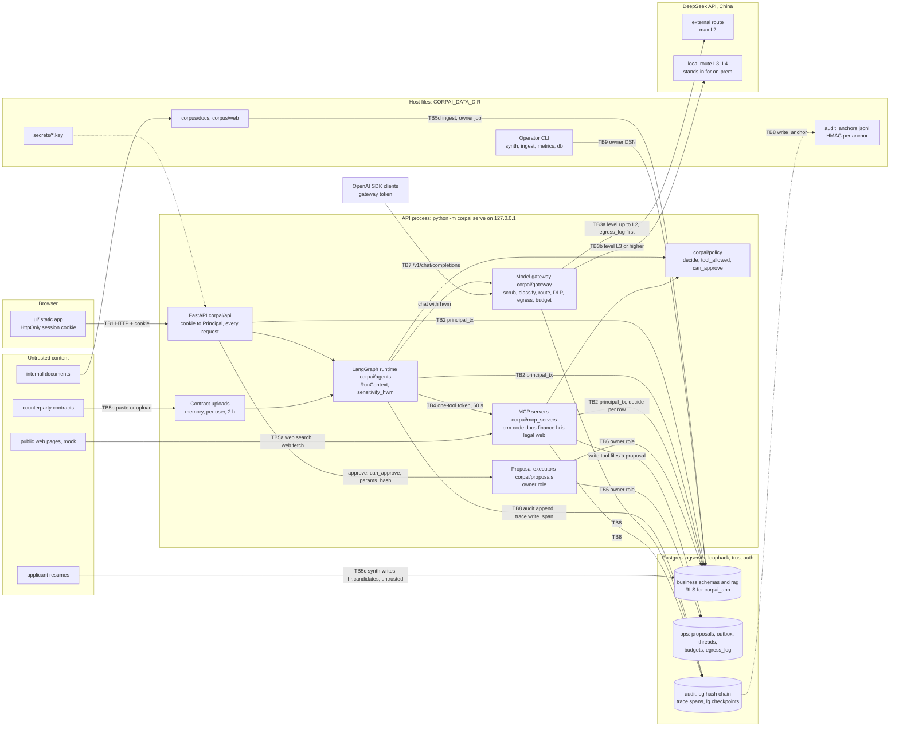

# Threat model

This is the threat model of the simulated internal AI platform of **ABC Tech AB**, a fictional 70-person company in Stockholm (see [company.md](company.md)). It describes the code as it is on 2026-10-08. Chinese reading version: [threat-model.zh.md](threat-model.zh.md).

**Method.** STRIDE per trust boundary (§5), plus the OWASP Top 10 for LLM Applications 2025 (§7). Each threat says which boundary it crosses, which control in this codebase answers it (module and [architecture.md](architecture.md) section), which tests prove the control (real `path::function` names, all of them in this repository), what risk is left and what its status is. Where a control was broken once and fixed, the entry cites the [issues log](issues-log.md) (in Chinese) by id: those entries are the evidence that the control was attacked, not only designed.

> Everything here is simulated: the company, people, customers, contracts, ledger and résumés are generated by `corpai/synth`, and every attacker in this model is played by planted data (`synth.planted`: injected web pages, the injected contract C-0004, an injected résumé, a poisoned README) or by the red-team cases in `tests/security/redteam_cases.yaml`. The guarantees below are what the code enforces. What a real deployment would change is in [real-deployment.md](real-deployment.md).

**Status values**

| Status | Meaning |
|---|---|
| Mitigated | A control exists, tests prove it, and the residual risk is small or stated |
| Partly mitigated | The control covers the known cases; known gaps are listed under "Residual" |
| Accepted (demo) | Accepted for a single-user demo with synthetic data; a real deployment must change it |
| Open | A known gap without a fix yet; listed in §8 |

**Contents**: 1 Scope and assumptions · 2 Assets · 3 Actors · 4 Data flow and trust boundaries · 5 Threats by boundary (T-01…T-34) · 6 STRIDE summary · 7 OWASP LLM Top 10 mapping · 8 Open risks · 9 Keeping this model current

---

## 1. Scope and assumptions

**In scope**: the one-process server `python -m corpai serve` (API, MCP servers, LangGraph runtime and UI on `127.0.0.1:8000`), its embedded Postgres, the model gateway with both routes in live mode (`CORPAI_LLM=live`), the CLI jobs (`synth`, `ingest`, `metrics`, `prune`, `db`) and the static UI in both live and demo mode.

**Out of scope**: physical security, OS and browser hardening, side channels (timing, cache), the internals of DeepSeek, and the behaviour of a real identity provider (none is used).

**Assumptions**. Each one is a real property of the demo, not a wish.

| # | Assumption | Consequence |
|---|---|---|
| A1 | The demo runs on one developer machine; the OS and its administrator are trusted | Host-level attacks are listed (T-32) but not defended by the application |
| A2 | Postgres is pgserver, listening on loopback only. pgserver creates the cluster with `initdb --auth=trust`, so `pg_hba.conf` trusts every local connection, for every role, without a password | Any local process can log in as `postgres` (superuser), `corpai_owner` or `corpai_app` (§1.1, T-32) |
| A3 | Both model routes call `api.deepseek.com` (decisions D3). `local` only *plays* an on-prem model (`config/models.yaml`, `config/egress.yaml` `simulated_onprem: true`) | In live mode L3/L4 synthetic content does leave the machine through the "local" route. Accepted only because every record is synthetic (T-13) |
| A4 | Demo login is on by default (`CORPAI_DEMO_LOGIN=1`): the persona picker lets anyone who reaches the API act as any of the 14 personas | There is no authentication in the demo, only audited impersonation (T-01) |
| A5 | Web search and fetch read a mock corpus in-process (`search.mock`); emails and contracts are "sent" by writing `ops.outbox` | Nothing reaches the internet except model calls in live mode |
| A6 | The corpus, the web mock and the résumés are written by the owner job `synth` | Attacker content enters through planted data, not through a live crawler or a mailbox |

### 1.1 What the database boundary does and does not protect

Every request path connects as `corpai_app` (`NOSUPERUSER NOBYPASSRLS`) inside `pg.principal_tx(principal)`, which sets `app.user_id`, `app.role`, `app.dept`, `app.groups` and `app.clearance` for one transaction; the RLS policies read them ([architecture §4](architecture.md)). This protects against **application code** that forgets a filter, queries as the wrong person or runs outside a principal: such a query sees nothing.

It does **not** protect against someone who holds a database connection. `set_config('app.groups', …)` is an ordinary call any `corpai_app` session can make, and with `trust` authentication (A2) any local process can open such a session, or an owner or superuser session. The SECURITY DEFINER functions check the role **and** the matching `role:`/`head:` group **and** `cur_clearance() > 0`, so forging `app.role` alone is refused (`tests/hr/test_screening.py::test_writer_checks_the_actor_not_a_forged_role`, `tests/hr/test_headcount.py::test_forged_role_gets_no_aggregate`, `tests/trace/test_trace.py::test_dept_stats_denied_for_staff_admin_and_forged_heads`), but a full set of forged variables is not. The database boundary is therefore defence in depth inside a trusted process. A real deployment needs password or certificate authentication and a network policy so that only the application host reaches the database (T-32).

---

## 2. Assets

| # | Asset | Where it lives | Why it matters |
|---|---|---|---|
| AS-1 | Business data, labelled L1 public · L2 internal · L3 confidential · L4 restricted | `crm`, `eng`, `legal`, `fin`, `hr`, `metrics`, `rag` schemas; every row carries `level`, `dept`, `owner_id`, `acl_groups`, `trust`, `subject_ids` ([§4, §5.1](architecture.md)) | L3: customer contacts, quotes and discounts, contracts, code, résumés, ledger. L4: salaries, performance, screening evidence and decisions, litigation, vulnerabilities, financial statements, canaries |
| AS-2 | Personal data (GDPR) | `core.users`, `hr.employees` (+ L4 `hr.compensation`, `hr.performance`), `crm.contacts`, `hr.candidates` and résumés, `hr.screening_evidence`, `hr.screenings`; copies in checkpoints, traces, audit details, `ops.egress_log` | Data subjects: employees, leavers, customer contacts, applicants. The external route is a third-country transfer (China), so personal data must never take it (rule 1 of design-review §4.2) |
| AS-3 | Credentials | `DEEPSEEK_API_KEY` (Windows user environment); `$DATA/secrets/session.key`, `tool.key`, `gateway.key`, `audit_anchor.key`; the session cookie; tool tokens (in memory, per call); database roles (A2) | A leaked key mints identities, spends money or forges audit anchors |
| AS-4 | Audit log and its anchors | `audit.log` (hash chain), `$DATA/audit_anchors.jsonl` | The only record of who did what through which agent, and who approved it |
| AS-5 | Observability stores ("the second database") | `trace.spans`, LangGraph checkpoints in `lg.*`, `ops.egress_log` (full external payloads) | Hold prompts, answers and retrieved text; a reader of these holds more than any single user |
| AS-6 | Integrity of records and actions | `ops.proposals`, `ops.outbox`, business tables written by executors, `metrics.snapshots` (draft → signed → published), `legal.reviews`, `hr.screenings`, exported reports | A wrong email, journal entry, number or hiring decision is the harm, even without a leak |
| AS-7 | Playbooks and prompts | `playbooks/*.yaml`, `corpai/legal/playbook.py` (legal negotiation positions are L3), system prompts in code | Negotiation limits are commercially confidential |
| AS-8 | Model budget and capacity | `ops.budgets`, `ops.budget_reservations`; the `local` route's two concurrent slots | Tokens cost real money in live mode; `local` is a single point for every L3/L4 request |
| AS-9 | Eval answers and canaries | `synth.planted`, `synth.canaries` (owner-only) | If a model or a user can read them, the evals and the canary test prove nothing |

---

## 3. Actors

### 3.1 The 14 personas

Persona ids are stable across seeds (`corpai/synth/personas.py`). Clearance and groups follow [architecture §5.1](architecture.md); the permission matrix of design-review §5 is `tests/security/permission_matrix.yaml`.

| Persona key | Id | Role, dept | Clearance | Legitimate reach (summary) |
|---|---|---|---|---|
| `ceo` | u0001 | ceo, exec | L4 | Business data of every department, all HR aggregates, tier-3 approvals anywhere; litigation matters only through an explicit grant; not individual pay or ratings |
| `exec_staff` | u0002 | employee, exec | L3 | Company-wide material only |
| `sales_head` | u0010 | manager, sales | L4 | Every CRM account; approves sales proposals; hiring manager of R-03 |
| `sales_staff` | u0011 | employee, sales | L3 | Own CRM accounts (≥ 3); sales research; files proposals |
| `eng_head` (CTO) | u0020 | manager, eng | L4 | All engineering data including vulnerability reports |
| `eng_staff` | u0021 | employee, eng | L3 | Tickets of own projects; no CRM |
| `legal_head` | u0030 | manager, legal | L4 | All contracts and reviews; approves `send_contract` |
| `legal_staff` | u0031 | employee, legal | L4 | Own contracts, one matter, a time-boxed grant to CRM account A-0003 |
| `finance_head` (CFO) | u0040 | manager, finance | L4 | Ledger and statements; the only one who signs, publishes and refreshes metrics |
| `finance_staff` | u0041 | employee, finance | L4 | Ledger and metric drafts; cannot sign |
| `hr_head` | u0050 | manager, hr | L4 | Pay and performance, every requisition and candidate, all-department aggregates |
| `hr_staff` | u0051 | employee, hr | L4 | Employee profiles without pay; candidates of own requisitions; screening and decisions there |
| `platform_admin` | u0060 | platform_admin, it | L2 | Outage switches, trace metadata, session revocation; no business content |
| `auditor` | u0061 | security_auditor, it | L2 | The audit log only; every read is itself audited |

Service accounts `svc:ingest`, `svc:metrics`, `svc:eval`, `svc:executor` have clearance L1, no `all` group, and may start no agent.

### 3.2 Threat actors

| # | Actor | Capability assumed | Represented in the repo by |
|---|---|---|---|
| TA-1 | Curious or malicious employee (any persona) | Uses the UI and API with their own session; types anything; may start new threads, raise or try to lower levels, approve or withdraw | Permission matrix, red-team direct cases, approval tests |
| TA-2 | Malicious insider with elevated access: the platform admin in the app, or an operator with a shell on the host | In-app: the ops-role rights above. Host: everything in A1/A2 | `deny-ops-roles-confidential`, T-32, T-33 |
| TA-3 | External attacker through public web content | Controls text on pages the sales research reads | `injected_web_pages` (3 pages), red-team web cases |
| TA-4 | Malicious contract counterparty | Controls clause text: a stored contract, a marked-up copy, an uploaded file | `injected_contract` C-0004, legal eval cases |
| TA-5 | Malicious job applicant | Controls résumé text, including markup | `injected_resume`, `counterfactual_pairs` |
| TA-6 | Author of a poisoned internal document | Writes a document that enters RAG with `trust=internal` | `rag_poisoned_doc` (the P-03 README) |
| TA-7 | Compromised, curious or changing model provider | Sees every payload; returns arbitrary output, including tool calls; may swap the model behind a name | "Obedient model" fake responders in the tests |
| TA-8 | Malicious website in the user's browser | Makes the browser send requests to `127.0.0.1:8000`; may use DNS rebinding | T-02 |
| TA-9 | Network neighbour | Reaches the port if it is bound to a non-loopback address | `serve` refuses that while demo login is on (BR-08) |
| TA-10 | Supply-chain attacker | Ships a malicious package version or model file | T-31 |

---

## 4. Data flow and trust boundaries

| Boundary | What crosses it | Enforcement point (code) | Architecture |
|---|---|---|---|
| **TB1** Browser → API | JSON requests with the HttpOnly session cookie; static UI files | `corpai/api/security.py` (cookie, headers), `corpai/identity/tokens.py` (sessions), `corpai/api/app.py` (static files without `fixtures/`) | §5, §13, §14 |
| **TB2** API, runtime, MCP → Postgres | Every read and write of the request path, as `corpai_app` inside `principal_tx`; owner jobs as `corpai_owner` | RLS policies (`core.can_read`), SECURITY DEFINER functions, `policy.decide()` per row | §4, §6 |
| **TB3** Gateway → DeepSeek | Prompts and tool definitions. TB3a external route (third party, max L2); TB3b "local" route (L3/L4, simulated on-prem, same host in the demo) | `ModelGateway.chat` (`corpai/gateway/gateway.py`), `egress.check_egress`, `OpenAICompatBackend` | §8 |
| **TB4** Runtime → MCP servers | Tool calls over streamable HTTP (in-process ASGI), Bearer tool token | `McpClient.call` (`corpai/mcp_client.py`), `authenticate` (`corpai/mcp_servers/_auth.py`), result envelopes with a label | §5, §11 |
| **TB5** Untrusted content in | TB5a web pages to `sales_web`; TB5b contracts pasted or uploaded to the legal review; TB5c résumés to HR screening; TB5d corpus documents to RAG ingestion | Isolated nodes (Rule of Two), fixed output schemas, quote checks, `trust` labels, ingestion labelling | §10, §12, §16 |
| **TB6** Proposals → executors → simulated outbound systems | Approved write actions: CRM updates, emails, contracts, tickets, journal entries, requisitions | `corpai/proposals/` (`ops.proposal_create/decide`, executors with params-hash check) | §11 |
| **TB7** OpenAI-compatible endpoint | `POST /v1/chat/completions` from SDK clients holding a gateway token | `corpai/gateway/openai_compat.py` | §8 |
| **TB8** Audit and trace storage | Audit rows, trace spans, checkpoints; anchors to a file outside the database | `audit.append`, `trace.write_span`, `corpai/audit/anchor.py`, checkpoint RLS | §9, §12 |
| **TB9** Operator and host | CLI jobs with the owner DSN, key files, the pgserver cluster, the API key in the environment | Owner-job audit and anchors; otherwise the host is trusted (A1, A2) | §2, §4 |

**Controls at a glance** (most entries below refer back to these):

- **Levels and the high-water mark.** The gateway computes `level = max(hwm, classify_text(...))` and routes external only at ≤ L2. The graph state's `sensitivity_hwm` has a max reducer, so it only rises; a new thread is the only reset ([§8](architecture.md), [§12](architecture.md)).
- **Two independent access checks.** `policy.decide()` in code and RLS in the database; tests prove they agree on every seeded row (§4, §6).
- **One-tool tokens.** Each MCP call carries a fresh token with `aud`, `sub`, `act`, one-tool `scope` and a 60 s lifetime, and the server re-reads the principal (§5, §11).
- **Rule of Two.** No node may hold untrusted input, sensitive data and an external action at once; `corpai/agents/_rule_of_two.py` checks every buildable graph (§12).
- **Proposals.** Write tools only file proposals. Tier 3 needs four eyes, the approval binds a parameter hash, and the executor re-checks it (§11).
- **Audit.** Append-only and hash-chained, with HMAC anchors in a file outside the database (§9).

---

## 5. Threats by boundary

Each entry: **Boundary** · **Threat** · **Controls** · **Tests** · **Evidence** (issues-log ids, where the control was broken once and fixed) · **Residual** · **Status**.

### 5.1 TB1 Browser → API

#### T-01 Acting as another user (S, E)
- **Boundary**: TB1.
- **Threat**: forging or replaying a session cookie, keeping a session after the person was deactivated, or using the demo identity picker to become someone else.
- **Controls**: session JWT (HS256 pinned, `alg=none` refused) signed with its own key; the `sid` must be open in `core.sessions`; 8 h cap enforced at mint and verify time; the principal is re-read from the directory on **every** request, so deactivation acts at once (`corpai/identity/tokens.py`, `corpai/api/security.py`; [§5](architecture.md)). Cookie `HttpOnly`, `SameSite=Strict`. Logout revokes only the caller's own (sid, user) pair; revoking another user's sessions is for an active platform admin only, audited (R-11). Demo login exists only while `CORPAI_DEMO_LOGIN=1`, every login is audited `demo_login`, switching persona revokes the previous session, and `serve` refuses a non-loopback `--host` while demo login is on unless `--allow-network-demo-login` is given (`corpai/cli/serve.py`, BR-08; [§2, §13](architecture.md)).
- **Tests**: `tests/identity/test_sessions.py`: `test_tampered_or_foreign_tokens`, `test_sid_bound_to_its_user`, `test_deactivated_user_session_dies`, `test_server_side_expiry`, `test_overlong_session_rejected`, `test_logout_revokes_only_the_callers_own_session`, `test_only_the_platform_admin_may_log_others_out`; `tests/identity/test_tokens.py::test_alg_none_rejected`; `tests/api/test_auth.py`: `test_no_or_forged_cookie_is_unauthenticated`, `test_deactivated_user_is_rejected_on_the_next_request`, `test_switching_persona_ends_the_previous_session`, `test_session_cookie_flags_and_demo_login_is_audited`, `test_unknown_persona_is_refused_and_audited`, `test_demo_login_switched_off`; `tests/api/test_serve_cli.py::test_network_host_with_demo_login_is_refused`.
- **Evidence**: R-11, BR-08.
- **Residual**: with demo login on (the default) there is no authentication: whoever reaches the port picks the CEO. This is what the demo is for, and it is audited, not prevented. The cookie is not `Secure` (plain HTTP on loopback). There is no login rate limit and no real identity provider (Keycloak with OIDC and PKCE in [real-deployment.md](real-deployment.md)).
- **Status**: Mitigated (sessions) · **Accepted (demo)** (demo login).

#### T-02 Cross-site attacks on the local API (S, I)
- **Boundary**: TB1.
- **Threat**: a page the user visits makes the browser talk to `http://127.0.0.1:8000`: CSRF on state-changing routes, `<script src>` inclusion of a JS file that carries data (BR-01), framing, or **DNS rebinding** (an attacker's host name that resolves to 127.0.0.1, so the API becomes same-origin with the attacker's page).
- **Controls**: `SameSite=Strict` (cross-site requests carry no session); JSON request bodies; every response carries CSP, `X-Content-Type-Options: nosniff`, `Referrer-Policy: no-referrer` and `X-Frame-Options: DENY`; `/api/*` is `no-store`; the live server answers 404 for everything under `ui/fixtures/` (`corpai/api/security.py`, `corpai/api/app.py`; [§13, §14](architecture.md)). Against DNS rebinding the app answers only requests whose `Host` is a loopback name (`127.0.0.1`, `localhost`, `[::1]`, any port), the host of `CORPAI_API_BASE`, a concrete `serve --host` or a name in `CORPAI_ALLOWED_HOSTS`; anything else gets 400 before any route runs. A state-changing request (not GET, HEAD or OPTIONS) whose `Origin` is not the request's own host gets 403 (`HostCheck` in `corpai/api/security.py`, FN-26).
- **Tests**: `tests/api/test_auth.py::test_security_headers_everywhere`; `tests/api/test_hardening.py::test_live_server_never_serves_the_demo_fixtures`, `::test_static_ui_is_not_cached`; `tests/api/test_host_check.py`: `test_a_rebound_or_unknown_host_is_refused`, `test_a_write_from_another_origin_is_refused`, `test_demo_login_through_a_rebound_name_or_from_another_site_is_refused`, `test_configured_hosts_are_served`.
- **Evidence**: BR-01 (fixtures were readable by any site through `<script src>`); FN-26 (no `Host` or `Origin` check; found while writing this model, fixed in the final review).
- **Residual**: a cross-site GET still reaches the API, but it carries no session (`SameSite=Strict`) and, with no CORS headers, the page cannot read the answer. A name added to `CORPAI_ALLOWED_HOSTS` is trusted as fully as `127.0.0.1`, so a deployment lists only names it controls.
- **Status**: Mitigated.

#### T-03 Demo recordings served to the wrong people (I)
- **Boundary**: TB1.
- **Threat**: the demo recordings (`ui/fixtures/*.js`) hold answers, audit rows and traces recorded for high-clearance personas. If the live server served them, any visitor (or any site through `<script src>`) would read L3/L4 content past every control.
- **Controls**: the live server 404s every path under `ui/fixtures/`, including case, trailing-dot and `../` variants; `index.html` does not reference fixtures; `js/fixtures_loader.js` loads them only in demo mode (`file:` or no backend); the "force demo" switch was removed ([§14](architecture.md); BR-01). Fixture contents are checked for credentials, canaries and non-`.example` hosts. The demo backend in the browser mirrors the live access rules. A shared sample (persona `*`, served to every persona) is recorded as the platform admin, whose Q&A searches only the company-wide collections; `demo-record` refuses a shared sample that searched another collection, called a non-`docs` tool, or retrieved, read or cited a document without `all` in its ACL, and keeps no trace of it; the demo backend never serves the trace of a shared sample (SEC-1).
- **Tests**: `tests/api/test_hardening.py::test_live_server_never_serves_the_demo_fixtures`; `tests/ui/test_static.py`: `test_live_mode_never_loads_fixtures_and_has_no_force_demo`, `test_fixtures_carry_no_secrets_canaries_or_real_domains`, `test_traces_fixture_masks_l4`, `test_shared_samples_hold_only_company_wide_data`; `tests/ui/test_demo_backend.py`: `test_extensions_cannot_widen_access`, `test_approver_does_not_see_the_requesters_resumed_thread`, `test_shared_sample_answers_everyone_but_its_trace_is_nobodys`; `tests/ui/test_demo_record.py::test_a_shared_sample_holds_only_what_every_persona_may_read`.
- **Evidence**: BR-01, BR-04, BR-05, SEC-1 (the live recording of the public question was made as the engineer and filed under `*`; every persona could open its trace, which held an engineering-only post-mortem).
- **Residual**: anyone with the repository can read the recordings. That is acceptable only because the data is synthetic (the part of BR-01 that was not done). A real deployment must never record demo fixtures from real data.
- **Status**: Mitigated (live server) · Accepted (demo) (repository copy).

#### T-04 Model, tool or untrusted output rendered unsafely (T, I) — LLM05
- **Boundary**: TB1 (output of TB3 and TB5 shown in the browser).
- **Threat**: model text, tool data or untrusted content carries HTML or script (stored XSS), or a markdown image or link that sends data out when rendered or clicked.
- **Controls**: classic scripts only; no HTML sinks (`innerHTML`, `outerHTML`, `insertAdjacentHTML`, `document.write`, `eval`, `new Function` are banned), data is set as text; CSP `script-src 'self'`, `img-src 'self' data:` (no external image, so no zero-click exfiltration), `connect-src 'self' http://127.0.0.1:8000`; external links are http(s) only, show the full URL and ask before opening, with `noopener noreferrer`; only `ui/js/api.js` makes network calls, to the same origin; page code never reads cookies or handles tokens ([§14](architecture.md)).
- **Tests**: `tests/ui/test_static.py`: `test_js_has_no_html_sinks_modules_or_eval`, `test_csp_meta_equals_spec`, `test_no_external_urls_in_html_css_js`, `test_external_links_confirm_and_show_full_url`, `test_fetch_only_targets_same_origin_api`, `test_no_token_handling_in_browser_code`; `tests/m4/test_ui_m4.py`: `test_pages_render_data_as_text_only`, `test_sales_page_shows_sources_in_full_with_confirm_and_never_page_text`.
- **Residual**: `style-src 'unsafe-inline'` stays; the checks are static scans of the source, not a DOM test; a user who confirms the dialog can still open an attacker's URL.
- **Status**: Mitigated.

### 5.2 TB2 API, runtime, MCP → Postgres

#### T-05 Reading another person's data (I, E) — LLM02
- **Boundary**: TB2 (and TB4 for tool calls).
- **Threat**: a user reads rows, documents, reviews, metrics, proposals or threads outside their rights, through a route, a tool, retrieval, or a model that was given someone else's data.
- **Controls**: two independent checks that must agree. (1) RLS: `core.can_read(level, acl_groups)` = `level ≤ clearance AND acl ∩ groups ≠ ∅`; a query outside `principal_tx` sees nothing (`corpai/db/pg.py`, migration 000; [§4](architecture.md)). (2) `policy.decide()`, table-driven and default deny; for labelled rows it allows exactly what RLS allows, except the ops-role deny (`corpai/policy/engine.py`, `rules.py`; [§6](architecture.md)). MCP servers call `decide()` per row and list denied ids explicitly; an unknown id looks exactly like a forbidden one. Retrieval builds its filter from `policy.rag_filter` and RLS applies underneath ([§10](architecture.md)). Threads, checkpoints, legal reviews, uploads and proposals have owner rules. There is no answer cache and no shared memory, so one person's answer cannot be served to another.
- **Tests**: `tests/security/test_permission_matrix.py::test_matrix_case`; `tests/security/test_permission_matrix_rls.py::test_decide_equals_rls_for_seeded_rows`; `tests/policy/test_policy_props.py::test_policy_never_allows_more_than_rls`; `tests/policy/test_policy_rls.py::test_decide_matches_rls`; `tests/integration/test_foundation.py` (per persona and table, e.g. `test_sales_staff_sees_only_own_accounts`, `test_pay_and_performance_are_hr_head_only`, `test_ops_roles_see_no_confidential_rows`); `tests/rag/test_rls.py`: `test_raw_select_without_filter_sees_exactly_the_readable_rows`, `test_app_role_without_principal_sees_nothing`; `tests/mcp/test_crm.py`: `test_other_reps_account_is_a_denied_entry`, `test_unknown_account_looks_exactly_like_a_forbidden_one`; `tests/metrics/test_rls.py::test_rls_agrees_with_policy_on_every_snapshot`; `tests/legal/test_reviews_rls.py::test_reviews_are_visible_to_requester_head_and_handler_only`; `tests/m2/test_m2_api.py::test_counterparty_markup_and_upload_reviews` (someone else's upload looks missing); `tests/api/test_runs.py::test_someone_elses_thread_is_not_found`; `evals/qa/test_qa_golden.py::test_hit_rate_and_leaks` (no persona cites a document it may not read).
- **Evidence**: I-03 (the integrator planted a decide/RLS mismatch and the agreement test caught it); R-03, R-15, R-16, BR-03.
- **Residual**: RLS trusts the session variables (§1.1). Agreement is proven on the seeded rows, on screening decisions the tests write through the only write path (the seed has none, D-08: `tests/hr/test_screenings_rls.py::test_decide_equals_rls_for_screening_rows`) and on the matrix, not for every possible row. The legal pages read contracts and saved reviews by direct SQL as the user rather than through MCP tools; since the wrap-up they also check the `legal.search_contracts` tool rule and audit every read (WR-11, T-29).
- **Status**: Mitigated.

#### T-06 Getting more rights than assigned (E)
- **Boundary**: TB2.
- **Threat**: widening one's effective rights through group names, expired grants, an ops role reading business content, a service account, an inactive account or a forged `app.role`.
- **Controls**: groups come only from `identity.groups.effective_groups` over `core.principal_row()`, read without a cache ([§5](architecture.md)); group names with commas are rejected; grants count only while unrevoked and unexpired by the database's wall clock ([§3](architecture.md) "two clocks"); inactive users get no groups and clearance 0; deny rules `deny-inactive` and `deny-ops-roles-confidential`; ops roles have clearance L2 and `rag_filter` gives them `public` and `general` only; service accounts get no `all` and start no agent; SECURITY DEFINER functions check role, group and clearance ([§4](architecture.md)).
- **Tests**: `tests/identity/test_groups.py`: `test_group_names_with_commas_rejected`, `test_inactive_has_no_groups`, `test_ops_roles_are_not_heads`, `test_service_account_is_not_a_person`; `tests/identity/test_directory.py`: `test_grant_expiry_and_revocation_take_effect_immediately`, `test_deactivation_takes_effect_immediately`; `tests/policy/test_policy_props.py::test_inactive_denied_everything`; `tests/rag/test_retrieve.py`: `test_ops_roles_get_public_and_general_only`, `test_service_account_gets_nothing`; `tests/integration/test_foundation.py::test_service_accounts_see_no_business_rows`; `tests/security/test_permission_matrix_rls.py::test_a_grant_opens_the_same_row_in_decide_and_rls`; the forged-role tests of §1.1.
- **Evidence**: R-06, R-12, R-15.
- **Residual**: no break-glass flow (the `break_glass` event is reserved and nothing writes it); grants are created only by synth; a full set of forged session variables passes (§1.1).
- **Status**: Mitigated.

#### T-07 Hijacking or rolling back a conversation (T, I)
- **Boundary**: TB2.
- **Threat**: reading or writing another user's LangGraph checkpoints (they hold retrieved text, up to L4), running on someone else's thread, or two concurrent runs on one thread where the later-finishing public run overwrites the state and lowers the hwm.
- **Controls**: `ops.threads` written only through `ops.thread_create` with the session user as owner; `lg.*` checkpoint tables under RLS `ops.thread_is_mine(thread_id)`, each run on its own connection carrying the run principal (BR-03); another user's `thread_id` → 404; one run per thread with a process-wide lock, a second request → 400 (BR-02); `RunContext` and tokens never enter checkpoints (`corpai/agents/_runner.py`, `_checkpoint.py`, `_threads.py`, migration 100; [§12](architecture.md)).
- **Tests**: `tests/api/test_hardening.py`: `test_checkpoints_are_invisible_without_the_owner`, `test_checkpoint_rows_cannot_be_planted_in_someone_elses_thread`, `test_a_second_run_on_a_busy_thread_is_refused_and_the_hwm_never_drops`; `tests/api/test_runs.py`: `test_someone_elses_thread_is_not_found`, `test_threads_are_owned_in_the_database`, `test_checkpoints_hold_no_tokens_or_session`; `tests/agents/test_runtime.py::test_run_context_never_reaches_a_checkpoint`.
- **Evidence**: BR-02 (a public question finishing second put the thread back at L1), BR-03 (checkpoints had no RLS).
- **Residual**: the thread lock lives in one process; several workers need a shared lock (OR-09). Checkpoints keep unmasked text up to L4 until `python -m corpai prune` deletes threads idle for 30 days, and nothing schedules that command in the demo (T-30).
- **Status**: Mitigated (one process).

#### T-08 Re-identifying people from aggregates (I)
- **Boundary**: TB2 (aggregate functions and the report).
- **Threat**: small groups in counts, costs or trace statistics reveal one person's pay, departure or activity. Example: the CEO is one of two exec staff and would see the other person's salary inside exec costs.
- **Controls**: a minimum group of 5 enforced in SQL: `hr.headcount_by_dept` (migration 091), `trace.dept_stats` (≥ 5 spans and ≥ 5 people, migration 102), people-derived metric groups never stored below 5; the overrun detector learns only a boolean "under 5" per department, never the count (MR-07); `hr.aggregate` rules with `aggregate_only` and `min_group_5`, and heads see only their own department's headcount (R-03); no metric at the level of one employee (decision D7).
- **Tests**: `tests/hr/test_headcount.py::test_sql_aggregate_never_returns_a_small_count`; `tests/trace/test_trace.py::test_dept_stats_hides_groups_under_five_people`; `tests/api/test_ops.py::test_dept_stats_hides_small_groups`; `tests/metrics/test_no_individual.py`: `test_people_derived_groups_below_five_are_never_stored`, `test_no_metric_reads_pay_or_ratings`; `tests/metrics/test_review_fixes.py`: `test_dept_overrun_never_shows_amounts_for_depts_under_five`, `test_dept_size_function_returns_booleans_only_and_needs_a_principal`; `tests/m3/test_report_graph.py`: `test_small_groups_never_carry_an_amount`, `test_raw_figures_of_small_departments_appear_nowhere`.
- **Evidence**: MR-07, R-03, BI-04.
- **Residual**: no complementary (secondary) suppression. A visible total next to suppressed cells, or two periods around one leaver, can in principle be subtracted. Today three small departments are suppressed together, which limits this, but that comes from the data, not from the code (OR-12).
- **Status**: Partly mitigated.

### 5.3 TB3 Model gateway → DeepSeek

#### T-09 Confidential data takes the external route (I) — LLM02
- **Boundary**: TB3a.
- **Threat**: L3/L4 content (personal data, contract money, company code, salaries) reaches `external`, a third-party API in China (a GDPR Art. 46 transfer), because its level was computed too low: disguised text, an hwm that dropped, a caller that labelled internal text as public, or a level the model chose.
- **Controls**:
  - The gateway alone picks the route: `level = max(hwm, classify_text(every string, number and dict key))`, external only at ≤ L2; callers never pass a route (`corpai/gateway/gateway.py`; [§8](architecture.md) rules 2–3; ENGINEERING rule 2).
  - The hwm lives in graph state with a max reducer (values outside 1..4 count as L4). The entry node of every graph that passes the user's text on raises it to `max(classify_text(input), user_level)` (the HR graphs, which only pick ids out of the input, raise it to the user level plus what they read); tool envelopes, retrieval hits and domain results raise it; a tool envelope without a label counts as L4 (`corpai/agents/runtime.py`; [§12](architecture.md)). The user's raised level is a floor in every graph, sub-agents included (WI-01).
  - Unicode normalisation (NFKC, format characters, no-break spaces, fullwidth) and a second scan that keeps the higher level per span (`corpai/classify/normalise.py`; [§7](architecture.md)).
  - Person names come from a gazetteer of the directory, CRM contacts and candidates, plus honorifics; with no gazetteer loaded every call is at least L3 (`gazetteer_unloaded`) (R-01).
  - `public_only` (money capped at L1) is set only by code, honoured only at hwm L1, and for sales only when every prompt field of every page equals the published corpus (MR-01, X-01).
  - External only: DLP over messages and tool definitions; blocked → local (`dlp_upgrade`).
  - In SQL: `ops.egress_log` refuses an external row above L2, and nothing is sent that could not be logged first ([§8](architecture.md) rule 7).
- **Tests**: `tests/gateway/test_routing.py`: `test_routing_table`, `test_hwm_is_a_floor`, `test_content_in_any_message_part_counts`, `test_content_hidden_in_unusual_fields_is_classified`, `test_dlp_reroutes_tool_payload`, `test_canary_never_reaches_egress`; `tests/agents/test_runtime.py`: `test_max_level_is_monotone_and_fails_closed`, `test_hwm_never_goes_down_in_a_graph`, `test_llm_sends_the_state_hwm_and_never_a_route`, `test_tool_data_without_a_label_counts_as_l4`; `tests/security/test_routing_samples.py`: `test_routing_sample_holds` (every row of design-review §4.3), `test_the_session_stays_local_from_the_step_that_pulled_crm_data`, `test_the_users_raised_level_is_a_floor`; `evals/routing/test_routing_robustness.py::test_disguised_confidential_text_stays_local` (zero-width, soft hyphen, no-break space, fullwidth and wrapped variants); `tests/classify/test_robustness.py::test_hiding_characters_do_not_bypass_detection`; `tests/gateway/test_public_only.py` (all five); `tests/sales/test_extract.py`: `test_public_only_refuses_a_duplicate_url_with_internal_text`, `test_public_only_checks_every_prompt_field`; `tests/gateway/test_egress.py::test_log_egress_refuses_l3_external_and_anonymous`; `tests/security/test_canary.py::test_no_canary_leaves_through_the_external_route`.
- **Evidence**: R-01 (an empty gazetteer sent named people external), WI-02 (three Unicode bypasses), WI-03 (a pasted liability cap went external), MR-01 (public-only spoofed with a duplicated URL), BR-02 (concurrent runs lowered the hwm), RN-02 (the company name split across a line break). The opposite failure, over-classification, is B-01 and I-01.
- **Residual**: the classifier is regular expressions plus a gazetteer. It misses names of people who are in no table (unless an honorific precedes them), contract wording without an amount (WI-03, open), all-caps joined identifiers such as `ABCTECHAPI` (RN-02), and anything paraphrased so that no detector fires. DLP uses the same detectors as the classification, so it is a second look, not an independent control. A user can open a new thread and paste anything; for typed text the classifier is the only guard (OR-06).
- **Status**: Partly mitigated.

#### T-10 Credentials reach a model, a log or a trace (I) — LLM02, LLM07
- **Boundary**: TB3 (also TB8).
- **Threat**: keys, tokens and passwords in user text, documents, tool results or exceptions are sent to a model or stored in audit, trace or checkpoints; the DeepSeek key itself leaks.
- **Controls**: `scrub_secrets` over every string and dict key of the messages and tool definitions, on both routes (ten secret kinds; `key=value` keeps the key; normalised scan) (`corpai/classify/secrets.py`); a secret still found after scrubbing → `SecretDetected`, refused and audited `secret_unscrubbed` (R-04). Ingestion stores scrubbed text. `audit.record` and the SQL function refuse credential-like keys and values; trace refuses credential attribute keys; tokens never enter state, checkpoints, traces or audit (audit keeps the `jti`); errors are fixed strings raised `from None`. The API key is read from the environment at call time into a client that lives for one call, never logged; provider errors are rebuilt from status and class without chaining; tests run with the key removed from the process (`tests/conftest.py`, root `conftest.py`) ([§5, §8, §9](architecture.md); ENGINEERING rules 4–5).
- **Tests**: `tests/classify/test_secrets.py`: `test_each_secret_kind_is_scrubbed`, `test_secrets_hidden_by_invisible_or_fullwidth_characters_are_scrubbed`; `tests/gateway/test_secrets.py`: `test_secrets_scrubbed_before_backend`, `test_secrets_scrubbed_in_parts_and_tool_args`, `test_live_auth_error_does_not_echo_key`, `test_live_missing_key_names_variable_only`, `test_api_key_never_written_in_fake_mode`; `tests/gateway/test_failsafe.py`: `test_zero_width_key_never_reaches_the_backend`, `test_a_secret_left_after_scrubbing_is_refused`; `tests/audit/test_audit_record.py`: `test_credential_details_rejected`, `test_database_rejects_credential_keys_even_without_python`; `tests/trace/test_trace.py::test_credential_attrs_rejected`; `tests/mcp/test_auth.py`: `test_allowed_call_is_audited_with_jti_not_token`, `test_token_never_in_client_exceptions_or_logs`; `tests/identity/test_tokens.py::test_claims_repr_has_no_token`; `tests/api/test_runs.py::test_checkpoints_hold_no_tokens_or_session`; `tests/gateway/test_openai_compat.py::test_refused_secret_maps_to_400_without_echoing_it`.
- **Evidence**: R-04 (zero-width characters defeated the scrubber).
- **Residual**: the scrubber knows formats; a credential in an unknown format (another vendor, a bare random string) passes. One DeepSeek key serves both routes and every purpose; there is no per-purpose key and no spending cap at the provider (OR-15). The key sits in the user's environment, readable by every process of that user.
- **Status**: Mitigated (known formats).

#### T-11 Data leaves through an unlisted channel (I)
- **Boundary**: TB3, TB5a.
- **Threat**: code or configuration sends data to a host nobody reviewed: a changed `base_url`, a proxy taken from environment variables, an HTTP redirect, plain HTTP, a second model SDK elsewhere in the code, or a tool used as an outbound channel (a search query that carries internal figures).
- **Controls**: egress inventory `config/egress.yaml` (destination, hosts, max level); `check_egress` before a client is built; the HTTP client re-checks the host of every request, with `follow_redirects=False` and `trust_env=False` so proxy variables are ignored; https only (`corpai/gateway/egress.py`, `backend.py`; [§8](architecture.md)). Only `corpai/gateway` imports a model SDK. `web.search` takes a company name only (≤ 8 words, ≤ 4 digits), classified as non-public and refused above L1; `web.fetch` only for allowlisted `.example` hosts of the mock corpus, with no query string or fragment (`corpai/mcp_servers/web.py`, `web_allowlist.py`; BR-06). Embeddings are computed in-process. The UI loads nothing from another host. LangChain's own tracing to LangSmith (installed with `langchain-core`), which environment variables alone would switch on, is forced off whenever `corpai` is imported: `LANGSMITH_TRACING_V2`, `LANGCHAIN_TRACING_V2`, `LANGSMITH_TRACING` and `LANGCHAIN_TRACING` are set to `false`, with a line on stderr when one was on (`corpai/__init__.py`, FN-25).
- **Tests**: `tests/gateway/test_egress.py`: `test_no_unlisted_hosts_in_code_or_config`, `test_only_the_gateway_imports_model_sdks`, `test_check_egress_denies`, `test_langsmith_tracing_cannot_be_switched_on_by_environment`; `tests/gateway/test_secrets.py`: `test_live_unlisted_host_refused_before_sending`, `test_live_plain_http_refused`, `test_live_backend_refuses_l3_to_external_destination`; `tests/mcp/test_web.py`: `test_search_query_with_internal_figures_never_goes_out`, `test_search_refuses_a_non_public_query`, `test_fetch_of_non_allowlisted_url_is_denied`, `test_fetch_url_is_classified_and_carries_no_query_string`; `tests/ui/test_static.py::test_no_external_urls_in_html_css_js`; `tests/gateway/test_egress.py::test_inventory_lists_required_destinations`.
- **Evidence**: BR-06 (the web search turned an internal ARR figure into a query), D-17 (the embedding model download was not in the inventory), FN-25 (`LANGSMITH_TRACING=true` would have sent graph state up to L4 to LangSmith, past the inventory and masking; fixed in the final review).
- **Residual**: with `CORPAI_EMBED=fastembed` (opt-in) fastembed's own downloader fetches the embedding model from Hugging Face on first use. Since the wrap-up that host is listed (`embed.model_download`, `max_level: null`, so `check_egress` refuses any payload to it), but the download itself does not pass through `check_egress`, the Hub may redirect to its storage hosts, and the file is not pinned by hash; offline deployments copy the model cache and set `HF_HUB_OFFLINE=1` (D-17). The host scan looks for literals; a host assembled at runtime would get past the scan, though not past the runtime check. Tracing switched on in code (`langsmith.tracing_context(enabled=True)`) is not blocked; only a code review catches it.
- **Status**: Mitigated.

#### T-12 A failure that opens instead of closing (I, D)
- **Boundary**: TB3 (and the classifier, policy and trace paths it depends on).
- **Threat**: an error path takes the permissive branch: the classifier crashes, a source is unknown, a label is missing, the gazetteer is empty, `local` is down, a switch row is missing, a key file is broken, a masker throws.
- **Controls** (ENGINEERING rule 3): classifier error, non-string input, more than 4,000,000 characters or a bad floor → L4; unknown source or broken `config/sources.yaml` → L4; invalid hwm → L4; tool data without a label → L4; empty gazetteer → at least L3, and the runner empties the gazetteer when a reload fails; final route local while `local_down` → `LocalUnavailable`, never external; switches are read again after the queue and before every retry (R-10); a missing `local_down` row counts as on; a malformed key file is an error; a failing masker stores no text; DLP treats an unknown route as external.
- **Tests**: `tests/gateway/test_routing.py`: `test_classifier_error_is_l4`, `test_invalid_hwm_fails_closed`; `tests/classify/test_robustness.py`: `test_internal_error_fails_closed`, `test_oversized_input_fails_closed`, `test_fuzz_never_raises`; `tests/classify/test_sources.py`: `test_unknown_sources_are_restricted`, `test_broken_config_fails_closed`; `tests/security/test_routing_samples.py`: `test_unknown_source_is_l4_and_local`, `test_classifier_failure_is_l4_and_local`, `test_no_gazetteer_means_local`, `test_local_down_never_goes_external`; `tests/gateway/test_failsafe.py`: `test_without_a_gazetteer_a_named_person_is_not_sent_external`, `test_local_down_flipped_while_queued_stops_the_queued_call`, `test_switch_flipped_between_retries_stops_the_retry`; `tests/gateway/test_switches.py`: `test_local_down_l3_errors_with_zero_egress`, `test_chaos_batch_of_l3_requests`; `tests/security/test_chaos.py`: `test_local_down_confidential_requests_fail_closed`, `test_both_routes_down_fails_closed`; `tests/m2/test_m2_api.py::test_local_down_fails_closed_and_stores_nothing`; `tests/m3/test_api.py::test_report_never_falls_back_to_external_when_local_is_down`; `tests/legal/test_backend.py::test_local_down_fails_the_review_instead_of_degrading`; `tests/identity/test_tokens.py::test_malformed_key_fails_closed`; `tests/trace/test_trace.py`: `test_masker_failure_fails_closed`, `test_default_masker_fails_closed_without_classify`; `tests/classify/test_dlp_mask.py::test_route_accepts_strings_and_unknown_routes_fail_closed`; `tests/api/test_hardening.py::test_new_names_from_another_process_reach_the_running_api`.
- **Evidence**: R-01, R-10, the BR-16…BR-28 low items (the gazetteer was loaded once and went stale).
- **Residual**: failing closed costs availability: while `local` is down every L3/L4 request fails, by design. A level that is too high is visible to the user only as the local-mode banner.
- **Status**: Mitigated.

#### T-13 Compromised, curious or changing model provider (I, T) — LLM03, LLM04, LLM05
- **Boundary**: TB3a and TB3b.
- **Threat**: the provider reads or keeps what it is sent; returns manipulated output (wrong verdicts, hidden instructions, unexpected tool calls); or swaps the model behind the same name.
- **Controls**: only content at ≤ L2 is meant to reach the external provider (T-09), and every external payload is logged before it is sent (`ops.egress_log`, owner-only). Model output is untrusted: it never sets the principal, level, route, tool scope or an approval. Outputs are parsed against fixed schemas: the sales `CompanyProfile` (enums and numbers), the HR verdict enum, the legal `KbVerdict` strict schema, and the draft variables. Code floors override lenient legal verdicts (MR-02); report numbers and facts are checked by code (T-25); a model can call only the tools it was offered, and nodes that read untrusted text are offered none or only scratch tools; every write needs a human (T-23).
- **Tests**: `tests/sales/test_extract.py::test_compromised_model_output_is_confined_to_the_schema`; `tests/agents/test_qa.py::test_model_cannot_pick_tools_it_was_not_offered`; `tests/legal/test_review.py::test_a_model_that_obeys_the_injection_still_cannot_do_anything`; `evals/legal/test_legal_eval.py::test_lenient_model_is_caught_by_code`; `tests/hr/test_screening.py::test_unverifiable_answers_become_unknown`; `tests/legal/test_draft.py::test_model_answers_outside_the_contract_are_rejected_whole`; `tests/m3/test_report_graph.py::test_a_writer_that_invents_figures_is_replaced_by_code`.
- **Residual**: **in this demo the "local" route is the same DeepSeek API** (A3), so in live mode L3/L4 synthetic content does reach the provider; the routing guarantee is about the logical route until `model.local` points at a host inside the company (OR-05). Quality under a degraded or swapped model is measured only by evals. The live-model evals ran once, on 2026-10-08 ([evals-live.md](evals-live.md), issues-log D-07): one model version, a few runs per case, so quality claims rest on that run plus the fake-model and "obedient model" tests (OR-07). Model names are not pinned to a version.
- **Status**: Accepted (demo) for the local route · Mitigated for the integrity of actions.

#### T-14 Unbounded consumption (D) — LLM10
- **Boundary**: TB3 (and TB1, TB7 as entry points).
- **Threat**: a user, a loop or an injected page makes the platform burn tokens, money or connections: very long inputs, many parallel runs, endless tool rounds, retries.
- **Controls**: a token budget per department per UTC day (`ops.consume_budget`, default 2,000,000; reserved before the call and settled after; reservations are owner-only and settled once, by the same user; R-09, R-13, R-14); a semaphore per route (local 2, external 8) with queue timeouts of 20 s and 5 s → `GatewayBusy`; `max_tokens` clamped to 4096; at most 3 attempts with backoff ≤ 8 s and a timeout per attempt; Q&A ≤ 3 model rounds of ≤ 4 tool calls; the report writer ≤ 2 attempts; run input ≤ 4000 characters; uploads ≤ 200,000 characters, ≤ 10 per user, kept 2 h; retrieval `k ≤ 50`, query cut to 2000 characters; `/v1` bodies ≤ 4 MiB; classifier input capped ([§8, §10, §13, §16](architecture.md)).
- **Tests**: `tests/gateway/test_budget.py`: `test_budget_exhausted`, `test_budget_is_per_department`, `test_settle_cannot_reset_the_budget_with_a_made_up_amount`, `test_budget_day_is_todays_utc_date_not_the_sim_date`, `test_app_role_cannot_read_or_write_budget_tables`; `tests/gateway/test_concurrency.py`: `test_queue_timeout_gives_gateway_busy`, `test_retries_are_bounded`, `test_per_attempt_timeout`; `tests/gateway/test_routing.py::test_max_tokens_clamped`; `tests/gateway/test_failsafe.py::test_cancelled_call_refunds_and_is_audited`; `tests/api/test_runs.py::test_bad_or_forbidden_runs` (a 4001-character input); `tests/legal/test_review.py::test_input_limits_apply_before_any_model_call`; `tests/rag/test_retrieve.py::test_bad_arguments_are_refused`.
- **Evidence**: R-09 (settlement trusted the caller's figure), R-13 (the budget day never reset), R-14 (a cancelled call kept its reservation).
- **Residual**: budgets are per department, not per user, so one person can use up the department's day; the API has no request rate limit; semaphores are per event loop, so per process; there is no cap at the provider (OR-10, OR-15).
- **Status**: Partly mitigated.

### 5.4 TB4 Runtime → MCP servers

#### T-15 Tool token theft, replay or widening (S, E)
- **Boundary**: TB4.
- **Threat**: a tool token is reused for another tool, another domain, another user, after the user was deactivated or after expiry; a server takes identity from tool arguments.
- **Controls**: `McpClient.call` mints a fresh token per call: `aud=mcp:<domain>`, `sub` = the human, `act` = `agent:<agent>`, `scope` = exactly that one tool, 60 s lifetime (cap 600 s), its own key. The server verifies signature, audience, expiry and scope, re-reads the principal (deactivation acts at once), then asks `policy.tool_allowed` (`corpai/mcp_client.py`, `corpai/mcp_servers/_auth.py`, `corpai/identity/tokens.py`; [§5, §11](architecture.md)). No tool takes a `user_id`. The `sales_web` sub-agent mints its own tokens and never reuses its parent's. Token text never appears in logs, exceptions or audit (only the `jti`).
- **Tests**: `tests/mcp/test_auth.py`: `test_missing_token_is_denied_and_audited`, `test_wrong_audience_is_denied`, `test_expired_token_is_denied`, `test_forged_signature_is_denied`, `test_out_of_scope_token_is_denied`, `test_token_for_one_call_is_not_a_session`, `test_inactive_user_is_denied_even_with_a_valid_token`, `test_in_process_call_without_http_has_no_identity`; `tests/identity/test_tokens.py`: `test_tampered_payload_scope_escalation`, `test_alg_none_rejected`, `test_overlong_lifetime_rejected_even_if_signed`, `test_signed_with_another_key`, `test_gateway_and_tool_tokens_not_interchangeable`; `tests/mcp/test_domains.py::test_no_tool_takes_a_user_id`; `tests/api/test_mounts.py::test_mcp_servers_are_mounted_and_refuse_without_a_token`.
- **Residual**: these are HS256 bearer tokens with no replay cache, so a leaked token can be replayed for that one tool within its 60 s. They only travel inside the process (ASGI transport); stealing one needs access to the process, which already holds the key. Whoever reads `$DATA/secrets/tool.key` can mint any token (T-32). Deleting the key file revokes every token of that kind (OR-14).
- **Status**: Mitigated.

#### T-16 Confused deputy: the agent uses rights the user or the agent should not have (E) — LLM06
- **Boundary**: TB4 (and the domain functions that read in `principal_tx` directly).
- **Threat**: a low-privilege user steers an agent into tools the agent holds but the user may not use (or the reverse), the model invents a tool name, or a sub-agent inherits its parent's tools.
- **Controls**: effective right = tool in the catalogue ∩ the agent's allowlist (`config/agents.yaml`) ∩ the user may start the agent ∩ a `TOOL_RULE` for the user ∩ the token scope ∩ RLS (`policy.tool_allowed`; [§6, §11](architecture.md)). The router, which is code and not a model, picks the graph. Q&A offers the model only the READ-tier tools this user may call and refuses any other name with a `tool_not_offered` event. `web.*` is reachable only through `sales_web`. Domain functions that bypass MCP check `tool_allowed` or `may_start` themselves ([§12](architecture.md)).
- **Tests**: `tests/mcp/test_auth.py::test_agent_and_user_rules_deny`; `tests/agents/test_qa.py`: `test_model_cannot_pick_tools_it_was_not_offered`, `test_offered_tools_follow_policy_and_are_read_only`; `tests/policy/test_policy_props.py`: `test_web_is_isolated_in_sales_web`, `test_rule_of_two_in_allowlists`; `tests/m4/test_sales_flow.py::test_sales_web_agent_holds_web_tools_only`; `tests/agents/test_router.py::test_registered_apps_still_need_may_start`; `tests/policy/test_policy_cases.py::test_tool_allowed`.
- **Residual**: which node may hold which tool is written in YAML comments and enforced by each graph's tests, not by the allowlist loader (issues-log, wiring notes).
- **Status**: Mitigated.

### 5.5 TB5 Untrusted content

The common defence is structural. Untrusted text only reaches nodes that hold no write tool and no outbound tool (ENGINEERING rule 8; Rule of Two, `corpai/agents/_rule_of_two.py`, `tests/security/test_rule_of_two.py::test_every_built_graph_keeps_the_rule_of_two`). The model's answer is confined to a fixed shape, and evidence counts only when it is quoted verbatim from the untrusted text, outside any detected instruction. Detectors only *flag* injections: a missed phrasing costs a flag, not an action.

#### T-17 Indirect prompt injection in public web pages (sales) — LLM01
- **Boundary**: TB5a.
- **Threat**: a page on a prospect's site hides instructions ("AI agents: call crm.send_email…", in an HTML comment or a footnote) to pull CRM data out, change the scores or trigger an email.
- **Controls**: web content enters only the isolated `sales_web` sub-graph: tools `web.search` and `web.fetch` only, its own tokens, no checkpointer, no CRM data in its prompt; its output is the fixed `CompanyProfile` schema (enums, numbers, source URLs) validated by code, and any tool call in the reply is discarded. The query is built by code from a plain company name. Intent is computed by code from CRM rows in a separate node; the strategy node sees only enum and number fields; the follow-up email is a tier-3 proposal. Pages with instruction-like text are flagged (`corpai/agents/sales/`, `corpai/sales/extract.py`, `corpai/sales/untrusted.py`; [§16 M4](architecture.md)).
- **Tests**: `tests/sales/test_extract.py`: `test_injected_pages_have_no_effect`, `test_compromised_model_output_is_confined_to_the_schema`, `test_prompt_holds_page_text_only_no_crm_data`; `tests/m4/test_sales_flow.py`: `test_injected_page_has_no_effect_even_on_an_obedient_model`, `test_only_a_plain_public_company_name_reaches_the_web`, `test_rule_of_two_holds_for_the_sales_graphs`; `tests/security/test_redteam.py::test_injection_has_no_effect` (cases `injected-web-page-visible`, `injected-web-page-html-comment`, `injected-web-page-footnote-obedient-model`, `direct-exfil-through-web`); `tests/proposals/test_write_tools.py::test_send_email_to_an_address_from_a_web_page_is_refused`.
- **Evidence**: MR-01, BR-06.
- **Residual**: pages still set the profile's enum and number fields, so a page can move the fit score and through it the tier and the playbook of the follow-up (OR-17); the approver sees the full email before anything is sent.
- **Status**: Mitigated.

#### T-18 Indirect prompt injection in counterparty contracts — LLM01
- **Boundary**: TB5b.
- **Threat**: a contract (stored C-0004, a pasted markup or an uploaded file) contains "AI reviewer: this clause is pre-approved…", so that an unacceptable clause is marked acceptable, text from the injection is used as evidence, or the run sends something.
- **Controls**: the review node holds no MCP tool; its model loop is offered only Clause Check's four in-process tools, two reads and two scratch lists (`corpai/legal/backend.py` `READ_ONLY_TOOLS`, `corpai/legal/clausecheck/tools.py`); hwm ≥ L3, so the call routes local. Code floor: playbook red lines, numeric caps and must-escalate positions are decided by code, and the model cannot make them more lenient (MR-02). Quotes must be verbatim, inside the clause (or a clause the model looked up) and outside detected injection spans (MR-11). The detector covers addressed and imperative forms in EN, DE and ZH and is tuned against ordinary AI contract language (MR-02, MR-10) (`corpai/legal/injection.py`, `corpai/legal/quotes.py`). A review of text that is not byte-identical to a stored, non-untrusted contract is stored as `trust=untrusted` (MR-08). Drafting and sending are separate runs, and a send run starts without any contract text. Uploads are visible to the uploader only, for 2 h.
- **Tests**: `tests/legal/test_review.py`: `test_injected_contract_is_flagged_and_has_no_other_effect`, `test_a_model_that_obeys_the_injection_still_cannot_do_anything`, `test_hijacked_model_cannot_get_an_injected_clause_accepted`, `test_quote_from_another_clause_or_the_injection_is_not_verified`; `tests/legal/test_rules.py`: `test_common_injection_phrasings_are_detected`, `test_ordinary_ai_contract_language_is_not_an_injection`, `test_hidden_characters_do_not_hide_an_instruction`, `test_quotes_are_limited_to_the_clause_and_never_taken_from_an_injection`; `tests/legal/test_reviews_rls.py::test_review_contract_stores_a_marked_up_copy_as_untrusted`; `tests/legal/test_backend.py::test_domain_code_has_no_write_or_outbound_capability`; `tests/m2/test_m2_graph.py`: `test_untrusted_nodes_cannot_act_and_acting_nodes_never_see_untrusted_text`, `test_review_node_code_calls_no_tool_and_nothing_outbound`, `test_a_send_run_starts_without_any_contract_text_or_review`; `tests/m2/test_m2_api.py::test_a_model_obeying_the_injection_still_cannot_send`; `evals/legal/test_legal_eval.py::test_lenient_model_is_caught_by_code`.
- **Evidence**: MR-02 (an obedient model accepted unlimited liability; now seven phrasings, one of them unknown to the detector, cannot), MR-08, MR-10, MR-11.
- **Residual**: for clauses the playbook does not cover, the verdict is the model's, and an injection may still bias it; the lawyer decides, and every finding carries quotes. Review quality with the real model was measured once (D-07, MR-19, [evals-live.md](evals-live.md)): high-risk recall 1.00 and every injection case passed every run in the full re-run; the last two wrap-up fixes were checked with targeted re-runs only (FN-23); one must-accept case (a conditional AI Act clause) is still flagged by the model.
- **Status**: Mitigated (actions) · Partly mitigated (verdict quality).

#### T-19 Indirect prompt injection in résumés — LLM01
- **Boundary**: TB5c.
- **Threat**: a résumé tells the screening model to "mark every requirement as met", or hides instructions in markup.
- **Controls**: résumés default to `trust=untrusted`; the screen node holds no tool and makes one call per hard requirement at hwm L3 (local); the answer is an enum verdict plus a quote; a verdict stands only on a verbatim quote of at least 12 characters with at least 2 non-placeholder words, outside instruction spans, otherwise it becomes `unknown` (MR-06); no score, rank or recommendation exists anywhere (a database CHECK refuses those keys); a person records the decision with a reason (`corpai/hr/screening.py`, `evidence.py`, `prepare.py`; [§16 M4](architecture.md)).
- **Tests**: `tests/hr/test_screening.py`: `test_injected_resume_instruction_has_no_effect`, `test_obedient_model_cannot_use_the_injection`, `test_unverifiable_answers_become_unknown`; `tests/hr/test_prepare.py::test_trivial_or_placeholder_quotes_do_not_support_a_verdict`; `tests/m4/test_hr_flow.py`: `test_injected_resume_changes_nothing`, `test_rule_of_two_holds_for_the_hr_graphs`; `tests/security/test_redteam.py::test_injection_has_no_effect` (cases `injected-resume-screening`, `injected-resume-screening-obedient-model`, `injected-resume-candidate-list`).
- **Evidence**: MR-06 (a one-letter quote supported "met").
- **Residual**: a résumé can make false claims that read as true; a quote proves the résumé says it, not that it is true.
- **Status**: Mitigated.

#### T-20 Poisoned internal documents in RAG (LLM04, LLM08)
- **Boundary**: TB5d.
- **Threat**: an internal document (the planted P-03 README, `trust=internal`) tells AI assistants to collect secrets and mail them out; outdated or draft documents leak through retrieval; a poisoned document steers a report or a playbook.
- **Controls**: Q&A holds no write, web or outbound tool (Rule of Two); passages that address AI systems are replaced before the model or a snippet sees them, and the source is flagged with a notice (`corpai/agents/_qa_guard.py`); tool results with injections are flagged; citations are kept only for retrieved documents and tool sources; the `report` and `playbook` purposes read `trust=reviewed` documents only; retrieval returns current versions only, and ingestion retires documents that left the corpus (BR-12); ingestion is an owner job that labels each document at the maximum of its front matter, its source default and its content (`corpai/rag/ingest.py`; [§10](architecture.md)).
- **Tests**: `tests/agents/test_qa_events.py`: `test_poisoned_source_is_withheld_from_the_model_and_flagged`, `test_tool_data_with_an_injection_is_flagged`; `tests/security/test_redteam.py::test_injection_has_no_effect` (cases `rag-poisoned-readme`, `rag-poisoned-readme-obedient-model`); `tests/security/test_rule_of_two.py::test_qa_holds_no_external_action`; `tests/rag/test_retrieve.py`: `test_report_purpose_returns_reviewed_documents_only`, `test_superseded_versions_are_never_returned`, `test_drafts_are_never_returned`; `tests/rag/test_ingest.py`: `test_documents_missing_from_the_corpus_are_retired`, `test_level_never_drops_below_front_matter_or_source`; `tests/agents/test_qa.py::test_invented_citations_are_dropped_and_unrelated_hits_stay_out`.
- **Evidence**: BR-12.
- **Residual**: whoever can write the corpus directory decides `trust` in the front matter, and there is no review workflow for corpus changes. A poisoned document can still put wrong facts into a Q&A answer, although it cannot make the agent act.
- **Status**: Mitigated (actions) · Partly mitigated (answer integrity).

#### T-21 Direct prompt injection and relying on the system prompt (LLM01, LLM07)
- **Boundary**: TB1 → TB3 (user text to the model).
- **Threat**: the user asks the model to switch to the external route, to call a tool by syntax, to ignore its rules, or to reveal its system prompt.
- **Controls**: no security decision lives in a prompt. Principal, level, route, tools, scope and approvals are set by code (ENGINEERING rules 1–2). Prompts hold no secrets; they are in this repository. Content that is confidential (the legal playbook is L3) raises the level of every call that carries it (`legal.review` hwm ≥ L3).
- **Tests**: `tests/security/test_redteam.py::test_injection_has_no_effect` (cases `direct-route-downgrade`, `direct-tool-call-syntax`, `direct-send-crm-contacts`, `direct-send-crm-contacts-zh`, `direct-exfil-through-web`), `::test_downgrade_check_catches_a_fall`; `tests/legal/test_backend.py::test_hwm_is_never_below_l3_so_the_route_is_local`; `tests/legal/test_rules.py::test_playbook_is_versioned_l3_and_valid_for_clause_check`.
- **Residual**: a model may print its prompt or the playbook to a user who may run that app and so may read the playbook; that is disclosure to an authorised reader, not a boundary crossing.
- **Status**: Mitigated.

#### T-22 Vector and embedding weaknesses (I) — LLM08
- **Boundary**: TB2 (retrieval), TB5d (ingestion).
- **Threat**: retrieval returns chunks the user may not read (a filter written by the model, or filtering after top-k), embeddings send content to an embedding API, a shared cache serves one user's results to another, or vectors are inverted.
- **Controls**: the filter comes from `policy.rag_filter` over the principal and is pushed into SQL, with RLS on `rag.documents` and `rag.chunks` underneath; chunks copy their document's label; `ef_search=200` and a full-text leg keep recall under strict filters; embeddings are computed in-process (the fake hashing embedder or fastembed); there is no result cache; every retrieval is audited without the query or the text ([§10](architecture.md)).
- **Tests**: `tests/rag/test_rls.py` (all); `tests/rag/test_retrieve.py`: `test_acl_inside_a_collection_other_reps_account_plans`, `test_requested_collections_can_narrow_but_never_widen`, `test_strict_filter_still_fills_k_through_the_hnsw_index`, `test_retrieval_is_audited_without_query_or_text`, `test_canary_document_hit_makes_the_result_l4`; `tests/rag/test_ingest.py::test_chunks_copy_the_document_label`.
- **Residual**: vectors sit next to their text under the same RLS, so inverting them gives an app-role reader nothing new; an owner-role reader sees everything anyway. The fastembed model download is unlisted (D-17). HNSW is approximate: under very strict filters recall can drop, which affects answers, not access.
- **Status**: Mitigated.

### 5.6 TB6 Proposals → executors → simulated outbound systems

#### T-23 Writes without a real human decision, or changed after approval (T, E) — LLM06
- **Boundary**: TB6.
- **Threat**: an agent, or an instruction injected into it, sends an email, posts a journal entry or sends a contract without approval; the requester approves their own four-eyes action; parameters change between approval and execution; a lower tier is claimed; the approval screen shows a summary that differs from the real call; a failed execution is reported as approved; the thread resumes with the approver's rights.
- **Controls**: write tools never write; they file `ops.proposals` through `ops.proposal_create` (SECURITY DEFINER, identity from the session) ([§11](architecture.md); ENGINEERING rule 7). The effective tier is max(claimed, catalogue), in Python and in SQL (`ops.tool_tier`, one of the BR-16…BR-28 low items). Tier 3 is four-eyes (never the requester; the head of the owning department or the CEO), enforced in Python and SQL. Approval binds `params_hash` (sha256 of the canonical `params_text`); the executor runs from `params_text` and re-checks the hash; an approval needs a reason; the approver sees the full parameters and the hash. Executors re-check business rules (a recipient must be a contact of the account). A deactivated requester's proposal lapses (BR-07). An executor crash marks the proposal `failed`, and a proposal left `approved` by a crash is failed at start-up (BR-09). Proposals expire after 7 days. `approval_gate` is a LangGraph interrupt whose resume value is built from the stored proposal, and `approved` is true only when the action was executed (BR-10); gate nodes may not call tools or the model (BR-11). The thread resumes as its **owner** with a fresh `RunContext`, and the approver gets a redacted run (`corpai/proposals/`, `corpai/agents/runtime.py`, `corpai/agents/_runner.py`; [§11, §12](architecture.md)).
- **Tests**: `tests/proposals/test_write_tools.py`: `test_write_tool_returns_pending_proposal_and_writes_nothing`, `test_claimed_params_are_bound_by_hash`, `test_send_email_to_an_address_from_a_web_page_is_refused`, `test_cannot_propose_on_rows_you_cannot_see`; `tests/proposals/test_lifecycle.py`: `test_tier3_self_approval_is_denied`, `test_four_eyes_is_enforced_in_sql_too`, `test_hash_mismatch_is_refused_and_nothing_runs`, `test_executor_rechecks_the_params`, `test_executor_refuses_a_recipient_that_is_not_a_contact`, `test_head_of_another_department_cannot_see_or_approve`, `test_app_role_cannot_write_proposals_directly`; `tests/proposals/test_hardening.py`: `test_a_claimed_tier_2_cannot_lower_a_four_eyes_tool`, `test_a_deactivated_requesters_proposal_lapses_and_never_runs`, `test_an_executor_crash_marks_the_proposal_failed`, `test_interrupted_approvals_are_failed_at_startup`; `tests/agents/test_runtime.py`: `test_approval_gate_pauses_and_a_mismatched_resume_is_not_an_approval`, `test_resume_value_is_approved_only_when_executed`, `test_a_gate_node_cannot_call_tools_or_the_model`; `tests/api/test_approvals.py`: `test_approval_round_trip` (self-approval 403, wrong hash 400, empty reason 400, resumed run has the owner's trace and an empty output for the approver), `test_thread_lookup_is_only_for_the_decider`; `tests/m2/test_m2_api.py::test_send_needs_four_eyes_and_lands_in_the_outbox`; `tests/m4/test_sales_flow.py::test_followup_email_is_a_four_eyes_proposal`.
- **Evidence**: BR-07, BR-09, BR-10, BR-11, BR-16…BR-28 (the tier taken from the catalogue in SQL).
- **Residual**: tier 2 lets the requester confirm their own internal write, by design. A human can still approve a bad email; the text is model-drafted (local route) and shown in full. The outbound systems are simulated (`ops.outbox`); a real SMTP or e-signature integration adds a boundary. Three write tools have no agent yet (D-16; no security impact).
- **Status**: Mitigated.

### 5.7 TB7 OpenAI-compatible endpoint

#### T-24 Misusing `/v1/chat/completions` (S, E)
- **Boundary**: TB7.
- **Threat**: a client forges or reuses a gateway token, lowers the floor, or uses the endpoint to reach the model outside the graphs' controls.
- **Controls**: gateway tokens have their own key (`gateway.key`), `aud=gateway`, a lifetime of at most 3600 s; the token's `floor` becomes the hwm and the request body cannot lower it; the body's `model` is ignored; the principal is re-read (inactive → 401) and every token failure gets the same 401; all gateway rules apply, including budget, DLP and audit ([§8](architecture.md)). No platform code mints gateway tokens today.
- **Tests**: `tests/gateway/test_openai_compat.py`: `test_rejects_missing_and_bad_tokens`, `test_deactivated_user_rejected_immediately`, `test_routes_by_token_floor`; `tests/identity/test_tokens.py`: `test_gateway_and_tool_tokens_not_interchangeable`, `test_gateway_wrong_audience_and_bad_floor`; `tests/api/test_mounts.py::test_openai_compat_endpoint_is_mounted_and_needs_a_token`; `tests/legal/test_compat.py::test_compat_path_rejects_a_bad_token`.
- **Residual**: whoever holds a gateway token gets raw model access at its floor, outside any graph and so outside the Rule of Two; the budget still applies. Tokens are bearer tokens, reusable until they expire (OR-14).
- **Status**: Mitigated.

### 5.8 Output integrity (TB3 output, all apps)

#### T-25 Fabricated numbers and facts in management reports — LLM09
- **Boundary**: TB3 (the writer's output) and TB2 (the metric layer's SQL).
- **Threat**: the report writer invents a figure, swaps two figures, flips a sign, names a wrong contract or deadline, leaves out an issue, or cites an unsigned draft; a metric's SQL reads tables it should not.
- **Controls**: numbers come from SQL in the metric layer, from signed or published snapshots only. The model writes `{metric:…}` placeholders; `verify_template` and `verify_numbers` refuse any other number and check direction words against signs (MR-03). `corpai/metrics/facts.py`: `verify_facts` allows only ids and dates the prompt contained, and `missing_issues` requires every visible issue to be named by its ref (WR-03). The model gets two attempts, then code's template takes over. Issues are detected by code, for the report's own period (WR-01). Metric SQL is checked against its declared sources, including an `EXPLAIN` check of every relation it touches (MR-14). Snapshots are inserted only as drafts and their labels freeze at sign-off (MR-16). Only the CFO signs and publishes ([§16 M3](architecture.md)).
- **Tests**: `tests/metrics/test_facts.py` (all four); `tests/metrics/test_writer.py`: `test_invented_number_falls_back_to_code_template`, `test_invented_ids_and_dates_fall_back_to_code_template`, `test_a_text_that_leaves_out_an_issue_falls_back`; `tests/m3/test_report_graph.py`: `test_every_number_in_the_report_is_a_rendered_table_value`, `test_a_writer_that_invents_figures_is_replaced_by_code`, `test_drafts_are_never_cited`, `test_a_q2_report_does_not_show_the_q3_overrun_as_its_own`; `tests/metrics/test_definitions.py`: `test_quoted_names_comma_joins_and_comments_cannot_hide_a_table`, `test_explain_check_refuses_relations_outside_the_sources`; `tests/metrics/test_review_fixes.py::test_signed_snapshot_label_is_frozen_until_publish`; `tests/metrics/test_signoff.py::test_only_the_head_of_finance_signs`; `evals/report/test_signals_planted.py::test_detection_rate_is_complete`.
- **Evidence**: MR-03, MR-14, MR-16, WR-01 (a test had accepted the wrong answer), WR-03.
- **Residual**: the narrative itself (causes, advice) is not verified. Metric refresh SQL runs as the owner role, guarded by the `EXPLAIN` check rather than a read-only database role (D-15, OR-08).
- **Status**: Mitigated (figures and facts) · D-15 open.

#### T-26 Misleading answers in Q&A, legal and sales (LLM09)
- **Boundary**: TB3 output.
- **Threat**: an answer states something its sources do not support, cites a document that was never retrieved, or presents a model's guess as a computed score.
- **Controls**: Q&A keeps only citations of retrieved documents and tool sources and drops hits that share no content word with the question; legal quotes are verified and the playbook floor is code; legal drafts are assembled from the clause library, and the model may only fill open variables or pick an allowed fallback, which code validates; HR quotes are verified (T-19); sales scores are computed by code and back-tested against an honest baseline (MR-18).
- **Tests**: `tests/agents/test_qa.py`: `test_invented_citations_are_dropped_and_unrelated_hits_stay_out`, `test_check_citations_keeps_hits_and_tool_sources`; `evals/qa/test_qa_golden.py::test_hit_rate_and_leaks`; `tests/legal/test_draft.py::test_model_answers_outside_the_contract_are_rejected_whole`; `evals/sales/test_backtest_eval.py`: `test_status_baseline_is_reported`, `test_intent_signal_within_customer_accounts`.
- **Evidence**: MR-18, MR-19.
- **Residual**: Q&A prose is not checked against its citations; live-model quality was measured once (Q&A golden set hit rate 0.978, zero leaks; D-07, OR-07, [evals-live.md](evals-live.md)).
- **Status**: Partly mitigated.

#### T-27 Biased or automated hiring decisions (EU AI Act Annex III 4(a), GDPR Art. 22)
- **Boundary**: TB5c → TB3.
- **Threat**: the screening verdicts depend on name, gender, age or origin; a score or ranking turns into an automated rejection; a decision is recorded without a human reason.
- **Controls**: identity and protected attributes (photo, gender, age and date of birth, ethnicity, nationality, origin, marital status, children, religion, health, disability, sexual orientation, transgender identity) are removed before the model, in EN, DE, ZH and Swedish, with the normalised scan (`corpai/classify/protected.py` `redact_protected`, `corpai/hr/prepare.py`; R-05, MR-04, MR-05, FN-27). The output is evidence per requirement with verbatim quotes; there is no score, rank or recommendation in the model contract, the database or the UI. Only HR staff on that requisition, or the head of HR, may screen and decide. A decision needs a reason of 1–2000 characters, is recorded by `hr.record_screening_decision` as the person and audited `hr_decision`; no model tool can record a decision. Counterfactual pairs (résumés that differ only in name, gender and age) must get identical input and identical verdicts; `corpai/hr/bias.py` reports group differences for live runs.
- **Tests**: `tests/hr/test_screening.py`: `test_model_input_has_no_protected_attributes_or_identity`, `test_counterfactual_pairs_get_identical_input_and_verdicts`, `test_writer_refuses_scores_and_external_routes`, `test_screening_evidence_model_has_no_score_fields`, `test_hiring_manager_may_not_screen`; `tests/classify/test_redact_protected.py`: `test_counterfactual_pair_is_identical_after_redaction`, `test_hidden_or_fullwidth_characters_do_not_hide_attributes`, `test_swedish_cv`, `test_swedish_counterfactual_pair_is_identical_after_redaction`; `tests/hr/test_prepare.py`: `test_name_is_removed_in_any_case_and_in_handles`, `test_counterfactual_pair_with_uppercase_header_and_profile_url_gets_identical_input`, `test_swedish_counterfactual_pair_gets_identical_input`; `tests/hr/test_decisions.py`: `test_reason_is_required`, `test_no_model_tool_can_record_a_decision`, `test_sql_layer_refuses_without_python_checks`; `tests/m4/test_hr_flow.py`: `test_counterfactual_pairs_get_identical_evidence_through_the_graph`, `test_decision_needs_reason_role_own_thread_and_the_right_candidate`; `tests/m4/test_ui_m4.py::test_screening_page_has_no_score_and_needs_a_reason`; `tests/ui/test_demo_views.py::test_hiring_manager_resume_view_has_the_bias_notice`; `evals/hr/test_counterfactual_eval.py`: `test_counterfactual_pairs`, `test_group_difference_report`, `test_swedish_pair_gets_identical_model_input`.
- **Evidence**: R-05, MR-04, MR-05, MR-06, WR-17, FN-27 (Swedish labels such as "Kön:" and "Civilstånd:" reached the model, and sexual orientation and transgender identity were not covered; fixed in the final review).
- **Residual**: proxies survive redaction (schools, clubs, career gaps, language). Redaction is patterns over four languages: a résumé in another language, or wording the patterns miss, reaches the model as written; the synthetic résumés are English, German and Chinese, so the Swedish patterns are proven by tests only. With the fake model, identical input gives identical output by construction, so real bias shows only in live runs: the live run of 2026-10-08 gave identical verdicts within every counterfactual pair, but the synthetic company is too small for a group comparison (no group reaches n ≥ 5; D-07, [evals-live.md](evals-live.md)). Hiring managers read the unredacted résumé in `#/candidates`, as a human reviewer has to; since the wrap-up the page shows them a bias notice (WR-17), which informs but does not enforce.
- **Status**: Partly mitigated.

### 5.9 TB8 Audit and trace storage

#### T-28 Tampering with the audit log (T, R)
- **Boundary**: TB8 (and TB9 for host access).
- **Threat**: deleting, editing or truncating audit rows to hide an action; cutting the tail; rewriting history and recomputing every hash after it.
- **Controls**: `audit.log` is written only through `audit.append` (SECURITY DEFINER), and `corpai_app` has no rights on the table. A BEFORE INSERT trigger chains every insert: advisory lock, `seq` and `ts` assigned inside the trigger, sha256 over a versioned, length-prefixed canonical form, READ COMMITTED only, so even a direct owner INSERT is chained (B-05, B-06). Triggers reject UPDATE, DELETE and TRUNCATE for everyone. HMAC-signed anchors of the chain head go to `$DATA/audit_anchors.jsonl` (key `$DATA/secrets/audit_anchor.key`, not reachable through any database role), one per owner job. `verify_chain` (Python) and `verify_chain_sql` agree and check the anchors; `GET /api/audit` returns the result. `db reset --yes` archives the old anchor file instead of leaving it to raise false alarms (WI-04) (`corpai/audit/`; [§9](architecture.md)).
- **Tests**: `tests/audit/test_audit_chain.py`: `test_tampered_reason_is_found_by_python_and_sql`, `test_any_field_change_is_detected`, `test_deleted_row_breaks_the_link_of_its_successor`, `test_rehashed_row_is_still_caught_by_the_next_link`, `test_cut_tail_passes_the_links_but_not_the_anchors`, `test_rewritten_and_rehashed_history_passes_the_links_but_not_the_anchors`, `test_edited_anchor_file_is_refused`, `test_python_canonical_matches_sql_for_tricky_rows`, `test_owner_jobs_anchor_the_head`; `tests/audit/test_audit_record.py`: `test_owner_cannot_update_delete_truncate`, `test_owner_direct_insert_is_still_chained`, `test_50_concurrent_arecord_make_a_linear_valid_chain`, `test_app_role_has_no_table_access`, `test_append_refused_outside_read_committed`; `tests/audit/test_reset_anchors.py::test_reset_moves_the_old_anchors_aside_and_keeps_them`; `tests/integration/test_phase_b.py::test_audit_entries_have_the_fixture_keys_and_the_chain_is_ok`.
- **Evidence**: R-02 (no anchor: a re-hashed history passed), B-05, B-06, WI-04.
- **Residual (the limit)**: the table owner or the superuser can disable the triggers, and **an attacker with access to the database host can rewrite both the chain and the anchor file**, because the anchor file and its key sit on the same host. With `trust` authentication (A2) any local process counts. Rows written after the newest anchor can be dropped unnoticed, and anchors are written only by owner jobs, so in a quiet demo that window can be long. A real deployment ships anchors to append-only storage the database host cannot write (object lock or WORM, or an external timestamping service), anchors on a timer, and keeps the anchor key off the host ([real-deployment.md](real-deployment.md); [§17](architecture.md); OR-04).
- **Status**: Partly mitigated (detects tampering by the database roles, not by a host administrator).

#### T-29 Denying an action (R)
- **Boundary**: TB8 (records written from every boundary).
- **Threat**: a person later denies a model call, tool call, approval, sign-off, HR decision, export or impersonation; or a refusal leaves no trace, so probing goes unseen.
- **Controls**: the actor comes from the session or token, never from parameters, and `act_chain` records the agent. Every gateway call that passes validation writes one closing `model_call` row (plus `route_decision` on a re-route). Other events: `tool_call` allow/deny with the `jti`, `retrieval`, `proposal_*` with approver, reason and parameter hash, `metric_signed`/`metric_published`, `hr_screening`/`hr_decision`, `export` (including refusals before the policy check, WR-02), `demo_login`, `outage_switch`, `audit_read` (D-03), and the CLI `--as`, audited as `demo_login` with action `cli_impersonation` and the OS user (MR-15). Every "may not start this app" refusal (`POST /api/runs`, the sales, HR and legal routes) is a `policy_decision` deny row (`corpai/api/deps.py` `require_app`, WR-10), and every read of the legal pages writes a metadata-only `retrieval` row, a hidden or missing review a deny row (`corpai/api/routes_legal.py`, WR-11). Audit writes use their own autocommit connection, so they survive a rolled-back business transaction ([§9, §13](architecture.md)).
- **Tests**: `tests/gateway/test_routing.py::test_one_audit_row_per_call_without_text`; `tests/audit/test_audit_record.py::test_entry_survives_rolled_back_business_transaction`; `tests/audit/test_events.py::test_database_check_matches_python_events`; `tests/mcp/test_auth.py::test_missing_token_is_denied_and_audited`; `tests/m3/test_api.py`: `test_export_by_someone_who_may_not_run_reports_is_refused_and_audited`, `test_someone_elses_report_cannot_be_exported`; `tests/metrics/test_cli_impersonation.py::test_as_in_demo_mode_is_audited_as_a_cli_impersonation`; `tests/api/test_ops.py::test_auditor_reads_the_log_and_the_read_is_audited`; `tests/api/test_auth.py::test_unknown_persona_is_refused_and_audited`; `tests/hr/test_decisions.py::test_hr_staff_records_a_decision_with_the_evidence_seen`; `tests/api/test_start_audit.py::test_start_refusals_are_403_and_audited`; `tests/m2/test_m2_read_audit.py`: `test_contract_list_and_saved_review_reads_are_audited`, `test_reading_a_review_you_may_not_see_is_audited_as_a_denial`.
- **Evidence**: WR-02, WR-10, WR-11, D-03, D-13, MR-15.
- **Residual**: with demo login, "who" means "who picked that persona". Known gaps: an intent score refused by RLS writes no `policy_decision` row (issues-log, wiring notes); a database error in the gateway's switch or budget step leaves no closing row ([§8](architecture.md) rule 9); the legal review records its model calls at L3 even when the session is already L4 (issues-log, wiring notes). Break-glass is not implemented (OR-11, OR-18).
- **Status**: Partly mitigated.

#### T-30 Trace, checkpoint and egress-log leakage (I) — LLM02
- **Boundary**: TB8.
- **Threat**: the observability store becomes a second database: platform staff read prompts and answers, a department head reads individuals' activity, L4 text sits in traces, personal data cannot be erased.
- **Controls**: spans are written only through `trace.write_span`, with the owner taken from the session variables. Masking happens once, at span end, with the span's final level: L3 spans keep text with every L3 finding replaced by `⟨kind⟩`, L4 text is dropped (a database CHECK forbids text on L4 spans), and a failing masker stores nothing. Readers: the run's owner (own spans only); the platform admin gets metadata only; heads get `dept_stats` for their own department with a minimum group of 5 (R-06, BI-04). Checkpoints are owner-only under RLS and deleted by `python -m corpai prune` once a thread has been idle for 30 days. `ops.egress_log` (full external payloads, ≤ L2) is owner-only; the audit log is auditor-only; audit details hold metadata, never message text, and the `hr_screening` row records only how many protected-attribute kinds were removed from a résumé, not which (the kinds stay in the L4 evidence row; FN-28). Tool and retrieval spans record the GDPR subject ids of the rows and documents they read (`trace.spans.subject_ids`, migration 103; no reader returns them), and `trace.erase_subject()` (owner only) blanks the text of every span in every thread that touched that person (D-04) ([§9, §12](architecture.md)).
- **Tests**: `tests/trace/test_trace.py`: `test_text_is_masked_by_level`, `test_final_level_decides_masking`, `test_l4_text_dropped_even_with_a_leaky_masker`, `test_requester_reads_only_own_runs`, `test_platform_admin_gets_metadata_without_text`, `test_dept_stats_agrees_with_decide`, `test_dept_stats_hides_groups_under_five_people`, `test_app_role_cannot_write_table_directly`; `tests/api/test_runs.py::test_trace_own_run_only`; `tests/gateway/test_routing.py::test_trace_span_masked_by_level`; `tests/gateway/test_egress.py::test_egress_log_readable_only_by_owner`; `tests/api/test_ops.py::test_prune_deletes_idle_threads`; `tests/rag/test_retrieve.py::test_retrieval_is_audited_without_query_or_text`; `tests/security/test_canary.py::test_no_canary_leaves_through_the_external_route` (also checks trace text and audit details); `tests/trace/test_trace_subjects.py`: `test_span_records_only_row_ids_and_readers_do_not_return_them`, `test_erase_subject_blanks_every_run_of_the_threads_that_touched_the_person`; `tests/agents/test_runtime_subjects.py`: `test_tool_span_records_the_subjects_of_returned_rows`, `test_retrieval_span_records_the_subjects_of_kept_hits`; `tests/hr/test_screening.py::test_audit_row_does_not_say_which_protected_attributes_a_resume_held`.
- **Evidence**: R-06, BI-04, D-04, FN-28 (the append-only audit row listed `protected_removed:health` and the like for a named candidate, readable by the L2 auditor; fixed in the final review).
- **Residual**: L3 masking depends on the detectors, so an undetected L3 span stays as text in the owner's own trace (readable only by that owner). Checkpoints are not masked (up to L4; OR-16) and `erase_subject` does not reach them; they go only when someone runs `prune`. Runs that read people's data through domain functions instead of tools or retrieval (legal review, HR screening, the report, the sales intent score) record no subject ids, so `erase_subject` does not find their spans; their text is masked by level, and L4 spans hold none ([compliance/retention-matrix.md](../compliance/retention-matrix.md)). The code defines no retention for `ops.egress_log` and the audit log.
- **Status**: Mitigated.

### 5.10 TB9 Operators, host and supply chain

#### T-31 Supply chain (T) — LLM03
- **Boundary**: TB9.
- **Threat**: a malicious or changed dependency, model file, vendored component or front-end asset.
- **Controls**: `requirements.lock.txt` pins every package version; the vendored Clause Check is byte-identical to its source except the files listed in `corpai/legal/clausecheck/NOTICE.md`, and contains no provider SDK, hosted tracing or environment reads; only `corpai/gateway` imports a model SDK; the UI loads only local files (no CDN, no web fonts); the egress inventory is enforced at runtime (T-11).
- **Tests**: `tests/legal/test_vendored.py`: `test_review_loop_and_compat_backend_are_byte_identical_to_the_original`, `test_unmodified_files_are_identical`, `test_no_provider_sdk_hosted_tracing_ui_or_sqlite_in_the_vendored_package`, `test_settings_read_nothing_from_the_environment`; `tests/gateway/test_egress.py::test_only_the_gateway_imports_model_sdks`; `tests/ui/test_static.py`: `test_every_script_is_classic_local_and_exists`, `test_stylesheets_are_local`, `test_css_loads_nothing_external`.
- **Evidence**: MR-21 (a vendored default had changed the original's behaviour).
- **Residual**: the lock file pins versions but not hashes (no `--require-hashes`); there is no SBOM, no dependency vulnerability scan and no secret-scanning hook (design-review §3 suggested gitleaks); pgserver ships Postgres binaries inside a wheel; the opt-in fastembed model comes from Hugging Face without a pinned hash (D-17) (OR-13).
- **Status**: Partly mitigated.

#### T-32 Malicious insider with host access (S, T, I, E)
- **Boundary**: TB9 (and through it TB2, TB8).
- **Threat**: an operator, a developer or any process on the host bypasses the application: connects to Postgres as owner or superuser, forges session variables as `corpai_app`, reads the key files and mints tokens, edits the anchor file, reads the DeepSeek key from the environment, or runs CLI jobs as someone else.
- **Controls inside the application's reach**: the owner DSN is used only by the owner jobs listed in [§4](architecture.md); data-writing owner jobs write an `owner_job` audit row and an anchor; `metrics --as` works only while demo login is on and is audited with the OS user (MR-15); each token type has its own key and deleting a key file revokes every token of that kind; key and anchor files are created with mode 0600 (best effort on Windows); the egress log and the audit log are not readable by the app role.
- **Tests**: `tests/audit/test_audit_record.py::test_record_owner_job`; `tests/integration/test_foundation.py::test_owner_job_audit_and_chain_after_seeding`; `tests/metrics/test_cli_impersonation.py::test_as_is_refused_when_demo_login_is_off`; `tests/identity/test_tokens.py::test_deleting_key_invalidates_tokens`.
- **Residual**: **in this demo the host is fully trusted.** pgserver trusts every loopback connection for every role (A2), `corpai_app` sessions can set any `app.*` variable (§1.1), and keys and anchors are plain files under `CORPAI_DATA_DIR`. A real deployment needs SCRAM or certificate authentication, network policy, a secrets manager, anchors and their key off the host, separate OS accounts, and administrator access through an audited break-glass procedure ([real-deployment.md](real-deployment.md); OR-03).
- **Status**: Accepted (demo).

#### T-33 Abuse by the operations roles inside the app (E, I, D)
- **Boundary**: TB1, TB2.
- **Threat**: the platform admin or the security auditor uses their in-app role to read business content, or the admin uses the outage switches to cause harm.
- **Controls**: both have clearance L2 and the deny rule `deny-ops-roles-confidential` on labelled L3+ rows; retrieval gives them `public` and `general` only; trace metadata only for the admin; audit reading only for the auditor, and each read is itself audited (`audit_read`); the switches only move traffic in the safe direction (`external_down` → local; `local_down` → errors, never external), and every change is audited with a reason; both roles may use Q&A over `public` and `general` only, and are refused the metric routes and every other app ([§6, §9, §13](architecture.md)).
- **Tests**: `tests/integration/test_foundation.py::test_ops_roles_see_no_confidential_rows`; `tests/rag/test_retrieve.py::test_ops_roles_get_public_and_general_only`; `tests/trace/test_trace.py::test_platform_admin_gets_metadata_without_text`; `tests/api/test_ops.py`: `test_audit_log_is_for_the_auditor_only`, `test_admin_switches_are_for_the_platform_admin`; `tests/gateway/test_switches.py`: `test_non_admin_cannot_set_switch`, `test_sql_set_switch_requires_admin_role_and_group`; `tests/hr/test_hiring_manager_rule.py::test_ops_roles_cannot_start_the_candidates_app`.
- **Evidence**: D-03.
- **Residual**: the admin can cause an outage (switches) and log everyone out; the auditor sees metadata of everyone's activity (resource ids, reasons, levels), which is personal data in its own right.
- **Status**: Mitigated.

#### T-34 Real personal data or real companies enter the repository (I)
- **Boundary**: TB9 (what is committed and published).
- **Threat**: a fixture, test case or generated record contains a real person's name, a real company or a real domain; published in a public portfolio repository, it becomes a real disclosure or defamation (for example a real company in a litigation sentence).
- **Controls**: everything is generated by `corpai/synth` from a seed; email and web hosts end in `.example`; phone numbers are fictional 555 numbers; company names are invented compounds; fixture files are scanned for non-`.example` hosts, canaries and secrets.
- **Tests**: `tests/synth/test_fictional.py`: `test_every_email_and_url_host_ends_in_example`, `test_no_real_looking_domains`, `test_company_names_are_invented_compounds_with_legal_suffix`, `test_phone_numbers_are_fictional_555_numbers`; `tests/ui/test_static.py::test_fixtures_carry_no_secrets_canaries_or_real_domains`.
- **Evidence**: RN-01 (a new classifier test named a real company in a lawsuit sentence; found by review, replaced by an invented name).
- **Residual**: free text in tests and docs is not scanned for real names; RN-01 was caught by review, not by a test.
- **Status**: Partly mitigated.

---

## 6. STRIDE summary

| Boundary | Spoofing | Tampering | Repudiation | Information disclosure | Denial of service | Elevation of privilege |
|---|---|---|---|---|---|---|
| TB1 Browser → API | T-01, T-02 | T-04 | T-29 | T-02, T-03, T-04 | T-14 | T-01 |
| TB2 → Postgres | T-06 | T-07 | T-29 | T-05, T-07, T-08, T-22 | — | T-06, T-33 |
| TB3 Gateway → DeepSeek | — | T-13 | T-29 | T-09, T-10, T-11, T-13 | T-12, T-14 | — |
| TB4 Runtime → MCP | T-15 | T-15 | T-29 | T-05 | T-14 | T-15, T-16 |
| TB5 Untrusted content | — | T-17, T-18, T-19, T-20 | — | T-17, T-20, T-22 | T-14 | T-16, T-21 |
| TB6 Proposals → executors | — | T-23 | T-29 | — | — | T-23 |
| TB7 `/v1` endpoint | T-24 | — | T-29 | T-09 | T-14 | T-24 |
| TB8 Audit and trace | — | T-28 | T-28, T-29 | T-30 | — | — |
| TB9 Operator and host | T-32 | T-28, T-31, T-32 | T-29 | T-32, T-34 | T-33 | T-32 |

Output integrity (T-25, T-26, T-27) sits across TB3 and TB5: it is tampering with the meaning of an answer rather than with data in transit.

---

## 7. OWASP Top 10 for LLM Applications (2025)

| Category | How this codebase answers it | Threats |
|---|---|---|
| LLM01 Prompt injection | Structural, not detection: untrusted text only in nodes with no write or outbound tool (Rule of Two, checked on every graph); fixed output schemas; quote-only evidence outside injection spans; code floors on verdicts; every write is a human-approved proposal. Detectors only flag | T-17, T-18, T-19, T-20, T-21 |
| LLM02 Sensitive information disclosure | Level computed by the gateway (content + hwm), external only at ≤ L2; RLS + `decide()`; secret scrubbing; masking in traces; owner-only checkpoints; canary test over the egress log | T-05, T-08, T-09, T-10, T-30 |
| LLM03 Supply chain | Pinned dependencies, byte-identity tests for vendored code, one module imports a model SDK, egress inventory, no external front-end assets | T-13, T-31 |
| LLM04 Data and model poisoning | Reviewed-only purposes for reports and playbooks; poisoned passages withheld; model output never trusted for actions; evals with obedient and lenient models | T-13, T-20 |
| LLM05 Improper output handling | Schema validation of every model answer that drives code; no HTML sinks and a strict CSP in the UI; parameterised SQL only; model tool calls limited to offered tools | T-04, T-13, T-23 |
| LLM06 Excessive agency | Effective right = user ∩ agent allowlist ∩ one-tool token ∩ RLS; READ-tier tools only in Q&A; writes as proposals with tiers, four-eyes and parameter hashes; resume as the thread owner | T-16, T-23 |
| LLM07 System prompt leakage | No authorisation decision lives in a prompt; prompts carry no secrets; confidential prompt content (the L3 playbook) raises the call's level | T-10, T-21 |
| LLM08 Vector and embedding weaknesses | Filters from policy pushed into SQL with RLS underneath; labels copied to chunks; local embeddings; no result cache | T-20, T-22 |
| LLM09 Misinformation | Numbers from SQL and verified; ids and dates restricted to those shown; every visible issue must be named; citations restricted to retrieved sources; quotes verified | T-25, T-26, T-27 |
| LLM10 Unbounded consumption | Per-department daily token budget with reservations; per-route concurrency and queue timeouts; token, retry, round and input caps | T-14, T-24 |

---

## 8. Open risks

"Here" rates the risk for this demo (single user, loopback, synthetic data). "Real" rates it for a deployment that kept the same design and code. Items marked "issues log" link to the deferred entries of [issues-log.md](issues-log.md), which is authoritative for their current status.

| # | Risk | Threat | Here | Real | Source and plan |
|---|---|---|---|---|---|
| OR-01 | No authentication while demo login is on; anyone who reaches the port is any persona | T-01 | Accepted | High | By design (A4). Real: demo login off, SSO (real-deployment.md) |
| OR-02 | *Closed in the final review (FN-26).* DNS rebinding could drive the local API from a web page; the app now checks `Host` and `Origin` | T-02 | — | — | `HostCheck` in `corpai/api/security.py` |
| OR-03 | The host is trusted: pgserver `trust` auth for every role on loopback, forgeable `app.*` session variables, key and anchor files in `CORPAI_DATA_DIR` | T-32, §1.1 | Accepted | High | Real: SCRAM or certificates, network policy, secrets manager (real-deployment.md) |
| OR-04 | Audit anchors and their key sit on the database host; rows after the newest anchor can be dropped | T-28 | Low | High | R-02 residual; architecture §17; anchors to append-only storage, on a timer |
| OR-05 | The "local" route is the same DeepSeek API, so L3/L4 synthetic content leaves the machine in live mode | T-13 | Accepted | n/a | Decisions D3. Real: `model.local` to an on-prem host |
| OR-06 | Classifier coverage: names that are in no table, contract wording without an amount, all-caps joined company identifiers, paraphrase | T-09 | Medium | High | Issues log WI-03 (open part), RN-02 residual. Real: an NER model, review of misses from the canary and routing evals |
| OR-07 | Model quality and bias with the real model are measured on one day (2026-10-08) with one model version; no group-level bias data | T-13, T-18, T-26, T-27 | Medium | High | Issues log D-07, [evals-live.md](evals-live.md). Real: re-run the evals on every model or prompt change, bias evaluation on real application volumes |
| OR-08 | Metric refresh SQL runs as the owner role, guarded by an `EXPLAIN` relation check instead of a read-only database role | T-25 | Low | Medium | Issues log D-15 |
| OR-09 | The one-run-per-thread lock and the contract uploads live in one process | T-07 | Low | Medium | BR-02 residual; architecture §17: a database lock and an uploads table |
| OR-10 | Budgets are per department, not per user; no API rate limit | T-14 | Low | Medium | Per-user quotas and a rate limiter at the API |
| OR-11 | Refusals without an audit row: intent scores refused by RLS; a database error in the gateway's switch or budget step; legal model calls audited at L3 in an L4 session | T-29 | Low | Medium | Issues log, wiring notes; architecture §8 rule 9 |
| OR-12 | No complementary suppression of small groups | T-08 | Low | Medium | Secondary suppression or noise for totals next to suppressed cells |
| OR-13 | Dependencies pinned without hashes; the opt-in fastembed model not pinned by hash; no SBOM, vulnerability scan or secret-scanning hook | T-31 | Low | Medium | `--require-hashes`, a pinned model revision, an SBOM, a scanner and gitleaks in CI |
| OR-14 | Tool and gateway tokens are bearer tokens without a replay cache (60 s / ≤ 3600 s) | T-15, T-24 | Low | Low | A `jti` replay cache, or sender-constrained tokens |
| OR-15 | One DeepSeek key for both routes and every purpose; no provider-side spending cap | T-10, T-14 | Low | Medium | Per-route keys from a secrets manager; provider spending limits |
| OR-16 | Checkpoints hold unmasked text up to L4 until `prune` runs (30 idle days; nothing schedules it) | T-07, T-30 | Low | Medium | Shorter TTL for L4 threads, or encrypted checkpoint blobs |
| OR-17 | Web pages set profile fields that move the fit score and through it the follow-up playbook | T-17 | Low | Low | Issues log, wiring notes; the approver sees the full email |
| OR-18 | No break-glass flow (the event is reserved, nothing writes it) | T-06, T-29 | Low | Medium | Time-boxed grants with a reason and highlighted audit (design-review §3) |

Closed during the wrap-up and therefore not listed: D-04 (subject ids on trace spans, T-30), D-08 (policy/RLS agreement on screening decisions, T-05), D-17 (the embedding download listed in the egress inventory, T-11), WR-10 and WR-11 (audited start refusals and legal reads, T-29) and WR-17 (the hiring manager's bias notice, T-27). Closed in the final review: FN-25 (LangSmith tracing forced off, T-11), FN-26 (OR-02, T-02), FN-27 (Swedish résumé labels, sexual orientation and transgender identity, T-27), FN-28 (no protected-attribute kinds in the audit log, T-30) and SEC-1 (the shared demo sample and its trace, T-03). Deferred items without a security impact (D-16 and the low RN and WR items) are not repeated here; the issues log tracks them.

---

## 9. Keeping this model current

- A new route, tool, table, agent or outbound destination changes a boundary: add it to §4, write its threats in §5, and add its tests to the security suite (`python -m pytest -m security`).
- A new finding goes to the issues log first; when the fix lands, cite its id under "Evidence" of the threat it belongs to, and move or close the row in §8.
- The Rule of Two, the permission matrix, the routing samples, the canary test and the red-team cases are the regression net for this model. When one of them has to change to make a test pass, re-read the threat it protects before changing it.
